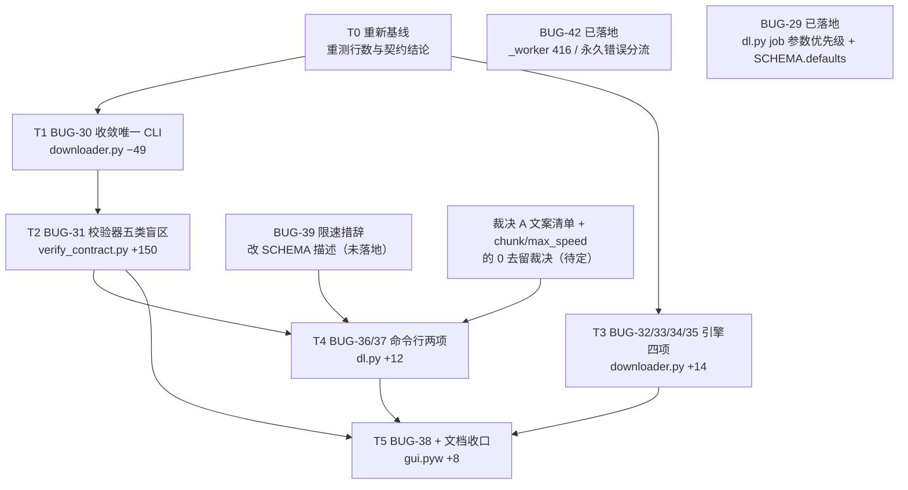

# 增量设计 · BUG-30 ~ BUG-38

本文是第二轮缺陷收口的**设计文档**，只描述「怎么改」，不含实现代码。配套的契约文档改动与代码改动按下文顺序执行。

- 作者：软件架构师（Bob）
- 日期：2026-10-31
- 适用仓库：`Download-tool`（本机工作区 `C:/Users/Administrator/Desktop/下载工具`）
- 上游输入：`docs/REVIEW.md`、`docs/BUGS.md`
- 下游产出：`docs/DESIGN-fix2.md`（本文）→ 契约文档改动 → 代码改动 → 回归测试 → `docs/BUGS.md` 状态更新

---

## 0. 范围、基线与前提

### 0.1 本文解决什么

评审第二轮后仍未处置的 9 条（BUG-30 ~ BUG-38）中，BUG-30 / BUG-31 / BUG-38 为 P2，BUG-32 ~ BUG-37 为 P3。本文给出每条的根因定位、推荐修法与备选修法的取舍理由、对应契约条目、测试用例与断言要点，并给出依赖关系、实现顺序、契约改动清单、文件级任务列表与风险清单。

本文**不覆盖** BUG-29、BUG-39 ~ BUG-42：这四条已在处理中或在评审中被独立列出。本文只在第 2.2 节标注它们与本方案的文件级冲突点与处置办法。

### 0.2 基线快照

本文写作时工作区处于「第一轮整改已落地、第二轮整改进行中」的状态，两个基线并存：

**基线 A —— 已固化部分**（评审后的既有状态，评审报告与 BUGS.md 的依据）：

| 项 | 值 |
|---|---|
| 单元测试 | 评审时 62 例全绿；对方 BUG-42 / BUG-29 落地后 **68 例全绿** |
| 契约校验 | 17 项全绿 |
| 模块 | `downloader` / `netio` / `taskqueue` / `dl` / `gui.pyw` / `diskutil` / `resume` / `mirrors` 共 7 个，2,601 行 |

**基线 B —— 在途部分**（第一轮工程师的 BUG-42 / BUG-29 已落地：`probe` 下沉到 `httpinfo.py`、文件名规整下沉到 `naming.py`、416 与永久错误在 `_worker` 三段分流、job 参数改哨兵）：

| 文件 | 行数 | CODE-003 上限 | 余量 | 备注 |
|---|---|---|---|---|
| `src/downloader.py` | 826 | 900 | 74 | 在途改动已落地并定型 |
| `src/netio.py` | 219 | 260 | 41 | 未动 |
| `src/dl.py` | 316 | 400 | 84 | 在途：`SCHEMA` 新增 `defaults` 顶层键（BUG-29 的机器可读默认值） |
| `src/gui.pyw` | 1003 | 1100 | 97 | 未动 |
| `src/taskqueue.py` | 154 | 220 | 66 | 未动 |
| `src/diskutil.py` | 117 | 160 | 43 | 未动 |
| `src/resume.py` | 79 | 90 | 11 | 未动 |
| `src/mirrors.py` | 62 | 80 | 18 | 未动 |
| `src/naming.py` | 77 | 90 | 13 | 在途新增，**上限已由对方登记** |
| `src/httpinfo.py` | 128 | 150 | 22 | 在途新增，**上限已由对方登记** |
| `docs/verify_contract.py` | 476 | **未登记** | — | 建议登记 700 |

> **重新基线要求（强制）**：本轮任何编码动作开始前，先重测上表的行数与 `python docs/verify_contract.py` 的结论。对方改动收口后契约校验恢复 17/17；本文所有行数增量都是**相对估算**，以重新基线后的实际值为准。

### 0.2.1 修订记录

| 版本 | 日期 | 修订内容 | 依据 |
|---|---|---|---|
| v1 | 2026-10-31 | 初稿 | — |
| v2 | 2026-10-31 | 按 software-engineer 的一轮核对修订：①`call_site` 的 `_measure_mirror` 条目改为 `probe`（`naming.filename_from` 已下沉到 `httpinfo.probe`，在 `downloader` 作用域命不中），并新增 `httpinfo` 模块的 `call_site` 块；②基线行数更新为对方下沉模块后的实测值（`downloader.py` 826 / `dl.py` 316 / `httpinfo.py` 128）；③CODE-003 的 `naming.py` / `httpinfo.py` 上限改用对方已登记的 90 / 150，并加「不得新增重复键」的约束；④补入 BUG-36 的 v1 基线指纹与 `introduced_in` 规则；⑤`no_private_access` 补明「只扫属性访问、不扫 `ImportFrom`」的边界；⑥T3 的容量依赖解除（对方下沉模块后余量回到 74 行），T1 与 T3 可并行；⑦测试基数由 62 改为对方落地后的 68 | software-engineer 的一轮核对 + 本文作者的 AST 实测复核 |
| v3 | 2026-10-31 | 按 software-engineer 的第二轮核对修订：①`introduced_in` 与规则 3/4 构成**三向约束**，任何一半落地都报红 —— 实测四种落地状态后，把 `introduced_in` 从 T2 推迟到 T4，T2 只声明规则 1~4 的自洽中间态；②T4 明确为「文案改动 → 算指纹 → 升 version → 写契约块」的原子落地，并给出兜底路径；③采纳「`args` 的「默认 N」改为由 `defaults` 派生」，实测 5 条字符串逐字相同、指纹零变化；④更正派生范围为 **5 处**（非 7 处，`chunk` / `max_speed` 的 0 不带「默认 N」）；⑤新增 R18/R19/R20 与两个用例 | software-engineer 的第二轮核对 + 本文作者的规则建模实测 |
| v4 | 2026-10-31 | 按 software-engineer 的第三轮核对修订：①**`chunk` / `max_speed` 也表达了默认值**（写成「0=自动」「0=不限」），只是措辞不同 —— 当时建议不派生而**钉死**为语义位，守卫用例加两条断言；②**派生改造从 T4 前移到 T2 第 0 步** —— 零指纹影响，且必须落在 T2 的 `schema_version` 契约块声明之前，让契约块拿派生后的 `SCHEMA` 比对 v1 指纹，**一次抓住「派生写错」**；③T4 的步骤由四步收敛为三步；④补入 software-engineer 拟定的 `_DEFAULTS` 参考结构与三条待核对性质。**注：v4 的①②已被 v5 按裁决 A 推翻** | software-engineer 的第三轮核对 + 本文作者的实测复核 |
| v5 | 2026-10-31 | 按**裁决 A**（主理人）重写 §1.7：①**否决** v4 的「从 `defaults` 动态渲染文案」建议 —— 派生会把「值的变化」伪装成「接口的变化」，产生伪漂移；改为选项 2「默认值只由 `SCHEMA["defaults"]` 承载，`args` 文案不再复述」；②T2 不再动 `src/dl.py`，派生改造整体撤销；③新增 `schema_defaults` 与 `literal_dict` 两类检查（分别守裁决 A 的「同一事实只写一处」与「`SCHEMA` 保持纯字面量字典」），契约校验项 21 → **24**；④最终指纹**不再预先写死**（v4 的 `96e5dbeb…` 作废），只保留确定值 v1 基线 `54471c4c…`；⑤新增 R21/R22/R23；⑥测试总数 89 → **92** | 主理人裁决 A + software-engineer 的三轮核对 |
| v6 | 2026-10-31 | 按**主理人最新裁决**重写 §1.7：①**指纹 payload 口径从三键改为「SCHEMA 减 version 的全部键」** —— 三键口径正是三人给出三个互不相同的指纹却无法收敛的根因；两个定案值（v1 `1eae02a1…`、v2 `e0e5aed3…`）已由架构用真实代码独立复算，逐字符一致；②**取消 `introduced_in` 机制**（前提已不成立）；③`schema_version` 检查由五条规则简化为四条；④`schema_defaults` 的规则定稿为「归一化 + 单向比对」（实测当前恰有 10 个参数无默认值，双向比对会全线误报）；⑤T4 改为四步顺序、**取消「version 保持 1」的兜底分支**（BUG-39 本轮必做）；⑥交付方式改为「代码片段交 software-engineer-2 合并」，架构侧不直接改 `verify_contract.py`；⑦登记已排除的误判冲突（删除 `main()` 与 `_path_lock` 调用不冲突） | 主理人最新裁决 |
| v7 | 2026-10-31 | 按**主理人最终裁决**定稿 §1.7：①**甲案定案**（保留「0=自动」「0=不限」），**乙案否决** —— 否决理由不是「同一事实只写一处」，而是「哨兵语义永不过期」：甲案在 `defaults["chunk"]` 改成 4 之后文案仍为真，乙案立刻变假且过期得静默；v5 把「文本里出现了数字」等同于「文本重复了默认值」，这个推理有错，已在 §1.7.2.1 更正；②`schema_defaults` 规则由「文案不含该默认值」改为**正则 `默认\s*(\d+)` 句式匹配**，分「未命中=合规 / 命中且相等=重复 / 命中但不等=漂移」三态 —— 按甲案，「文案不含该默认值」会误判 `--chunk`；③`literal_dict` 作用域明确限定在 `SCHEMA` 常量（`DEFAULTS = dict(...)` 不是字面量，扫到会误报）；④新增 §1.7.8 保留经复核仍有效的实测结论 | 主理人最终裁决 + software-engineer 的甲乙逐字清单 |
| v8 | 2026-10-31 | 补 §1.7.3.1「CLI-011 正文草案」：把**指纹口径三要素**（payload = SCHEMA 减 version 的全部键 / `json.dumps(payload, ensure_ascii=False, sort_keys=True)` / `sha256(...encode("utf-8")).hexdigest()`）写进契约**正文**而非只写在代码里 —— 口径若只活在代码里，将来一改，文档不会提醒任何人而校验器已换算法，契约自己就犯了本项目要消灭的那类漂移；另补「已知取舍：payload 含 `usage` ⇒ 任何文本改动都触发升版本」与 R23（口径变更需重算两个基线） | software-engineer 的核对 |
| v9 | 2026-10-31 | 按主理人交付清单逐项核对后收口：①**契约块改为三个顶层键** `version` / `fingerprint` / `previous{version, fingerprint}` —— 「只记三项」与规则 1「指纹变了 ⇒ version 必须 **>**」原本冲突（少了上一版版本号就只能比『不相等』，会放行降版），把上一版的两个值收进 `previous` 对象，既守住三项又让规则自洽；②`--max-speed` 括注按主理人定稿逐字采用（指纹不变）；③`literal_dict` 纳入本轮但**排在 T1–T5 之后**；④**修订记录加日期列**；⑤「甲案 7 条定稿文案」升为独立小节并标明「实施方逐字照抄」；⑥补主理人两条实测确认（`SCHEMA` 确为纯字面量、基线未被污染） | 主理人交付清单 |
| v10 | 2026-10-31 | 按 software-engineer 的实测证据补强 §1.7.3：上一版版本号不只规则 1（递增）要用，**规则 4（不许乱升）也要用** —— 三值口径下**降版与版本号通货膨胀两个方向都漏过**（实测证据已录入）；并给出形式对比（本文采用嵌套 `previous{version,fingerprint}`，顶层仍三键且两值原子不脱节；平铺四键语义等价，主理人可改）。另新增 §1.7.5.2 可选加固 `payload_spec`（把 R23 的「难懂的错」变成「一眼懂的错」，由主理人定是否纳入） | software-engineer 的实测证据 |
| v11 | 2026-10-31 | 按主理人最终裁决 + software-engineer 的补充意见收口：①**`schema_version` 改为四级判定**（内容漂移 / 版本号漂移 / 版本降级 / **递增与内容变化不同步·同真同假**），并附四种落地状态的预期结果；②**形状硬校验**列为实施硬要求 —— `previous` 内层必须恰好含 `version` 与 `fingerprint`，缺键/多键/类型错一律硬失败，**任何「取不到比较对象」都不得跳过判定**；③**payload 口径以 CLI-011 正文为准**，JSON 块不放 `payload_spec`（本轮不做，留档备查）；④`const_used` 改**两级匹配**（常量名本身 / `aliases` 显式声明的别名），并附实测：第一级对全部 6 个常量均命中（构造参数默认值表达式就是常量名本身），同时记录「第二级会遮蔽孤儿常量检测」这一副作用，建议当前 `aliases` 留空；⑤`call_site` 采用**做法 A**（两条 `_credited` 推迟到 T3），补 `_measure_mirror → probe` 与 `httpinfo.probe → filename_from` 两条；⑥契约块字段名统一为 `constants`（实施方现用 `names`，需改名） | 主理人最终裁决 + software-engineer 补充 |
| v12 | 2026-10-31 | 最后一轮收口：①**`const_used` 只保留第一级**（AST `Name` + Load，排除定义行）—— 主理人与架构各自独立扫描均证明第一级对全部 6 个常量命中，且第二级会**遮蔽**第一级刚抓到的孤儿常量；契约块保留 `aliases: {}` 空对象占位、字段名 `names` → `constants`（**`public_symbols` 的 `names` 不受影响**）；`files` 语义收紧为「读取发生的文件范围」，报红带文件+行号；②**形态校验硬失败规则**纳入本轮（`version` int / `fingerprint` 64 位小写 hex / `previous` dict 含前两者），形态不合法直接记 RED，**不允许「字段缺失所以跳过」而 PASS**；报红信息带当前实现的 payload 键集；③**R23 的缓解措施改写**为「口径写入 CLI-011 正文 + 报红带 payload 键集」，`payload_spec` 一节改为「本轮不做（留档备查）」，**不在文档里留下本轮未实现的方案**；④`call_site` 更新为 8 条（T3 已落地，AST 逐条复验全部成立，含两条 `_credited`）；⑤新增 §0.2.2 方法论：契约类规则的判据必须能被一段脚本复现，本轮三条被实测推翻的裁决已列表留档 | 主理人最后一轮裁决 |
| v13 | 2026-10-31 | 按主理人要求补入 **`introduced_in` 取消的适用条件（全键口径）** 段落 —— 取消它**不是「砍掉一个多余的机制」，而是「该机制的前提在新口径下不成立」**：该机制原为「payload 是键集子集」而设计（新增未覆盖的顶层键时指纹不变、SCHEMA 变了而检查照样绿）；全键口径下顶层键集恒定，「新增顶层键」必然改指纹，规则自动覆盖。并补入两组支撑实测（架构已独立复现）：「只加一个顶层键」在三键口径下**指纹不变（漏掉）**、全键口径下**变**；以及本轮的具体实例 —— BUG-29 新增 `SCHEMA["defaults"]`，三键口径下指纹**纹丝不动**（实测有/无 `defaults` 的三键指纹相等），全键口径下则逼着 version 升一级 —— 即「漏掉的部分 = 静默漂移的盲区」的实物。并注明：将来若把 payload 改回键集子集，`introduced_in`（或等价机制）必须同时恢复。另把「报红信息带 payload 键集」标明为**必做（B 方案）** | 主理人要求 + software-engineer 转交的因果链段落（架构已独立复现全部数值） |

### 0.2.2 方法论：契约类规则的判据必须能被一段脚本复现

本轮有三条裁决被实测推翻，共同点是**裁决时用了「看起来合理」而非「实测验证」的依据**：

| 曾经的裁决 | 推翻它的实测 | 正确结论 |
|---|---|---|
| 指纹 payload 只取 `{args, events, exit_codes}` 三键 | 三人算出三个互不相同的指纹 | payload 取「SCHEMA 减 version 的全部键」 |
| `schema_version` 契约块只记三项 | 三值口径下**降版**与**版本号通货膨胀**两个方向都漏过 | 必须携带上一版版本号 → 嵌套 `previous` |
| `const_used` 两级匹配（常量名 + 别名） | 第一级对全部 6 个常量均已命中；且第二级会**遮蔽**第一级刚抓到的孤儿常量 | 只保留第一级 |

**因此本文给每条契约规则都配了可复现的判据**：一段能跑的脚本 + 一张实测结果表。下一个维护者改规则时，先跑脚本、看结果，再改文档 —— 不要凭推理断定。

### 0.3 通用约束

| 约束 | 要求 | 本文如何遵守 |
|---|---|---|
| 先改契约，再改代码 | 行为变更同步契约条目 | 每条缺陷都列出「对应改动的契约条目」，任务顺序固定为契约 → 测试 → 代码 → 状态 |
| 规模上限（CODE-003） | 新增代码落在有余量的模块 | `downloader.py` 余量 74 行，足以容纳 T3 的 +14 行；其余增量落 `dl.py`（+84）、`gui.pyw`（+97）、`docs/verify_contract.py`（建议登记 700） |
| 测试先行 | 用例 docstring 写明缺陷编号，命名 `test_bugNN_*` | 每条缺陷给出用例名与断言要点；`docs/verify_contract.py` 的 `bug_tests` 检查做双向核对 |
| 纯标准库 | 不得引入第三方 | 本文涉及的改动全部用标准库（`ast` / `hashlib` / `json` / `unittest.mock`） |
| 行宽 ≤ 100 列 | CODE-009 | 新增的契约块 JSON 与代码片段均按 100 列折行 |
| 分层不反向 | `netio`/`diskutil`/`resume`/`mirrors`/`naming`/`httpinfo` 是叶子 | BUG-30 的结论明确排除「`downloader.main()` 转发给 `dl.main()`」这一方案，原因见 1.1 |
| 基线守住 | 契约 17 项、单元测试 68 例（本轮开始时的实测值） | 风险清单逐条给出预防手段 |

---

## 1. 逐条方案

### 1.1 BUG-30（P2）源码命令行入口与打包命令行能力不一致

**现象**　`src/downloader.py` 的 `main()` 只暴露 8 个参数，`src/dl.py` 的 `main()` 暴露 16 个；两者都叫「命令行入口」，能力却不同，README 至今宣传 `python src/downloader.py`。

**根因**　两套解析器并存，且**只有一套被契约与校验器覆盖**。`docs/CONTRACT-cli.md` 的 CLI-001 用 `schema_vs_argparse` 检查 `dl` 的 `SCHEMA` 与 `argparse` 是否一致；`downloader.main()` 没有任何检查覆盖，它的参数集在 BUG-19 之后就已经与正路分叉：加速源补全写成了 `build_mirror_urls(a.url)` 的第二份拷贝（正路是 `mirrors.expand_mirror_urls`），并且缺少 `--proxy` / `--max-speed` / `--hash` / `--json` / `--quiet` / `--job` / `--schema` 共 7 个参数。

**调用者核查（结论所依据的事实）**

| 位置 | 形态 | 是否调用 `downloader.main()` |
|---|---|---|
| `src/downloader.py` 末尾 `if __name__ == "__main__": sys.exit(main())` | 同文件自调用 | 是 —— **唯一一处** |
| `src/gui.pyw` `main()` | `from dl import main as cli_main` | 否，走 `dl` |
| `src/dl.py` 第 33 行 | `from downloader import EXIT_FAIL, EXIT_NO_MIRROR, DownloadError, DownloadTask, human` | 否 |
| `src/taskqueue.py` 第 20 行 | `from downloader import DownloadError, DownloadTask` | 否 |
| `src/gui.pyw` 第 121 行 | `from downloader import human` | 否 |
| `tests/test_engine.py`、`tests/test_bugs.py` | `import downloader as dl`；`from dl import main as dl_main` | 否，无一处调用引擎侧 `main` |
| `README.md` 132–133、`docs/CONTRACT-code.md` 第 141 行、`docs/CONTRACT-engine.md` CORE-001、`src/mirrors.py` 模块注释 | 文档与注释 | 引用，非调用 |

**结论：删除 `downloader.main()`。** 依据三条：

1. **无可达调用者**。唯一的调用者是同文件的 `__main__` 守卫；交付产物的命令行路径是 `gui.pyw:main()` → `dl.main()`；引擎的两个消费者（`dl.py`、`taskqueue.py`）与界面层都只从引擎取符号集合，从不取 `main`。删除它不改变任何可达行为。
2. **不能改成转发**。若让 `downloader.main()` 转发 `dl.main()`，就形成 `dl → downloader → dl` 的循环导入，违反 CODE-002 第 39 行「`downloader.py` 只允许依赖 `netio` / `diskutil` / `resume` / `mirrors`」。所以只剩两条路：永久保留第二套解析器，或删除。没有第三条路。
3. **保留成本高于删除成本**。删除要改 1 个函数 + 3 处文档；保留要永久维护两套 CLI 契约，而校验器只覆盖其中一套 —— 「能力不一致」之所以能长期存在，根因正是第二套解析器不受任何检查保护。BUG-30 若只删不改校验，等于把同一个坑重挖一遍。

**备选修法与取舍**

| 备选 | 结论 | 理由 |
|---|---|---|
| 保留 `downloader.main()`，运行时打 deprecation 警告 | 否决 | 警告不消除「两套能力」：用户看到的仍是缺 7 个参数的版本；没有终止日期的 deprecation 等于永久债务 |
| 保留 `main()` 但让它直接报错退出 | 否决 | 与删除等价，却保留了死代码与 CORE-001 的公开面，无收益 |
| 把 `dl.py` 改名成 `downloader.py`、引擎改名 | 否决 | 会同时打断 `from downloader import DownloadTask` 的既有导入方（README 的库用法、`taskqueue.py`、`gui.pyw`），代价远大于收益 |
| **删除 `main()`，`dl.py` 成为唯一命令行入口** | **采纳** | 唯一能同时满足「无第二套解析器」「无循环依赖」「校验器覆盖唯一 CLI」三者的方案 |

**删除后 `python src/downloader.py` 的行为**　模块变成纯库，直接运行不做事。为避免「静默成功」的困惑，保留一个 3 行守卫：

```python
if __name__ == "__main__":      # 引擎不是入口，这里只提示正确用法
    sys.exit("命令行入口已收敛到 dl.py，请改用：python src/dl.py --help")
```

这一处设计有两个附带收益：

- `import sys` **得以保留**（`sys.exit` 仍在用），因此**不需要动 `src/downloader.py` 的 import 区**——这消除了与在途 BUG-42 改动（需要在 import 区加 HTTP 错误相关导入）的冲突点。
- `tests/test_contract.py::test_source_no_dead_imports` 的白名单不含 `sys`，若把 `import sys` 删掉而 `__main__` 守卫也一并删除，该用例会因「死导入」报红。保留守卫即绕过这一风险。

**对应改动的契约条目**

| 条目 | 动作 | 内容 |
|---|---|---|
| CORE-001（`CONTRACT-engine.md` 第 1 节） | 改写 | `public_symbols` 的 `downloader` 列表删掉 `"main"`；引擎的公开面收敛为纯引擎 API |
| CODE-002（`CONTRACT-code.md` 第 2 节） | 改写 | 补一句「`dl.py` 是唯一命令行实现；`downloader.py` 不得出现 `argparse`」；分层图与第 39 行一并修订（顺带覆盖 BUG-40） |
| CLI-010（`CONTRACT-cli.md`，新增） | 新增 | 唯一命令行入口：入口点、参数集来源、引擎不得自带解析器 |
| CONTRACT-code.md 第 11 节检查清单 | 改写 | `python src/downloader.py --help` → `python src/dl.py --schema` |

**文档同步**　`README.md` 第 82 行（模块说明去掉「命令行入口」）、第 129–134 行（源码命令方式改为 `python src/dl.py ...`）、`src/mirrors.py` 模块注释（提到 `downloader.main()` 的一句）、`src/downloader.py` 模块头（去掉命令行用法段，改为「本模块是纯引擎」）。

**新增测试用例与断言要点**

| 用例 | 断言要点 |
|---|---|
| `test_bug30_downloader_has_no_cli_entry` | ① `hasattr(downloader, "main")` 为假；② `hasattr(dl, "main")` 为真；③ `src/downloader.py` 源码不含 `argparse`；④ `src/gui.pyw` 源码不含 `from downloader import main` |
| `test_bug30_readme_points_to_dl` | `README.md` 不含 `python src/downloader.py`，且含 `python src/dl.py` |

**预计行数增量**　`src/downloader.py` **−49**（删除 `main()` 约 52 行，保留 3 行守卫）；`docs/CONTRACT-engine.md` ±2；`docs/CONTRACT-cli.md` +5；`docs/CONTRACT-code.md` ±3；`README.md` ±4；`src/mirrors.py` −1。

---

### 1.2 BUG-31（P2）契约校验器存在五类盲区

**现象**　`docs/verify_contract.py` 的 17 项检查里，多类「文档说 A、代码是 B」的漂移检测不到。

**根因**　校验器只做**取值比对**（常量值、签名、键集合），不做**存在性比对**与**语义比对**。逐条拆解五类盲区：

| 类 | 盲区 | 现状为什么漏 |
|---|---|---|
| (a) | 常量是否真被使用 | `chk_const` 只比取值。一个从未被读取的常量照样 PASS —— BUG-27（`SLOW_BYTES` / `SLOW_WINDOW` / `MAX_RETRY` 只在定义处出现）就是这么活下来的 |
| (b) | 公共符号是否被越界访问 | CORE-001 明写「以下划线开头的符号视为私有」，但没有任何检查发现 `taskqueue.py` 读 `task._cancel` —— BUG-23 同理 |
| (c) | 契约行为是否落地 | CORE-007 写「`DownloadTask.run()` 必须调用 `expand_mirror_urls`」，但无人验证调用点存在 —— BUG-19（加速源只写在入口层、两个正式入口都没接）正是长期存在的原因 |
| (d) | 规模上限的语义 | `chk_max_lines` 只在「行数 > 上限」时报红。**`src/` 下新增一个模块若未登记上限，就完全不受约束**；已登记的文件若被删/改名，报错信息是「执行异常」而不是「文件未定义」 |
| (e) | 需求与测试的对应关系是否真的有效 | `chk_req_tests` 只验「测试函数存在」+「函数体内出现 REQ 编号字符串」。编号写在注释里、测试体是空的、一个断言都没有，都能蒙混过关 |

**推荐修法：为每一类补一类可执行的检查。** 五类中三类需要新增检查类型，两类在既有检查内加强语义（不增加检查项数量）。下面是可直接实施的规格。

#### (a) `const_used` —— 常量是否真被使用

**判定规则：只保留第一级（精确匹配）**

常量名作为 `ast.Name` 且处于 **Load 语境**（`ctx=ast.Load`）出现一次，即算「被使用」；否则判失败。

**为什么不能用裸文本匹配**　本项目已有 `test_source_no_dead_imports` 这类静态检查。若用裸文本（grep）匹配，常量**定义行自身**（`SLOW_BYTES = 15 * 1024`）就会命中 → 恒为「已使用」→ 检查等于空转。这正是 `check_anchors` 空转过一轮的同类陷阱，**不能重犯**。因此必须**排除定义行本身，只认「读取」**（`ast.Name` + `ctx=ast.Load`）。

**当前代码的实测：第一级对全部 6 个常量都命中**

主理人曾担心「`SLOW_BYTES` / `SLOW_WINDOW` / `MAX_RETRY` 的实际引用形态是 `self.slow_kb` / `self.slow_sec` / `self.retries`，不是常量名本身」。架构与主理人**各自独立**跑了 AST 扫描，结论一致：**在 AST 层面这个担心不成立** —— 构造参数的**默认值表达式**里就写着常量名：

```
downloader.py:271   slow_kb=SLOW_BYTES // 1024,     ← ast.BinOp(Div, Name)
downloader.py:272   slow_sec=SLOW_WINDOW, retries=MAX_RETRY,
```

这三个常量都是 `ast.Name` 且 `ctx=Load`（`SLOW_BYTES` 在 `BinOp` 的左操作数里，同样是 Load 语境），因此**第一级全部命中**：

| 常量 | 第一级命中位置 |
|---|---|
| `BLOCK` | `downloader.py:174`、`:473` |
| `MIN_CHUNK` | `downloader.py:405`、`:510` |
| `MAX_CHUNK` | `downloader.py:504`、`:510` |
| `SLOW_BYTES` | `downloader.py:271` |
| `SLOW_WINDOW` | `downloader.py:272` |
| `MAX_RETRY` | `downloader.py:272` |

**第二级（构造参数别名）已作废 —— 它会遮蔽它要抓的缺陷**

曾提议第二级：`aliases` 显式声明 `SLOW_BYTES` → `slow_kb`，别名的读取也算「被使用」。**该机制本轮不实现**，因为它有一个决定性的副作用：

- 若有人把默认值改成硬编码（`slow_kb=15 * 1024`，不再引用 `SLOW_BYTES`），
  - 第一级：`SLOW_BYTES` 无任何读取 → 判「未使用」→ **RED ✓**（这正是要抓的回归）
  - 第二级：`slow_kb` 仍被读取（`self.slow_kb = slow_kb`）→ 判「已使用」→ **漏过 ✗**

**第二级把第一级刚抓到的缺陷又放过去了。** 一个检查机制里，若高精度规则与低精度规则并存、而低精度规则会吞掉高精度规则的判定，那低精度规则就是**净负收益** —— 故作废。

**但契约块里保留 `aliases` 字段为空对象 `{}`** —— 两个理由：
1. 字段在契约里占位，说明「将来可能需要」，实现者不会以为漏了而自行发挥；
2. 将来真需要第二级时，机制已就位，只需填内容。

**`files` 的语义**：**读取发生的文件范围**（不是「常量定义在哪些文件」）。契约正文要写明这一点。

**报红信息必须带文件 + 行号**　否则维护者拿到「某常量未被使用」却不知道去哪查。报错的形态应类似：`SLOW_BYTES 从未被读取（扫过 downloader.py / dl.py / taskqueue.py / gui.pyw）`。

**JSON 描述**

```json
{"type": "const_used", "module": "downloader",
 "constants": ["BLOCK", "MIN_CHUNK", "MAX_CHUNK",
               "SLOW_BYTES", "SLOW_WINDOW", "MAX_RETRY"],
 "aliases": {},
 "files": ["downloader.py", "dl.py", "taskqueue.py", "gui.pyw"]}
```

> **字段名以 `constants` 为准**（主理人裁决用词）。实施方当前写的是 `"names"` —— 契约块与实现必须一致，实施方需改名并补 `aliases` 字段。当前 `aliases` 为空：六个常量第一级全部命中，不需要别名（见上文实测）。

**实现要点**

1. 解析 `files` 中每个文件的 AST，收集 `ast.Name` 且 `ctx is ast.Load` 的 `id` 集合；
2. 判定 `X in used` 即通过；
3. 失败信息列出「从未被读取的常量」。

**怎么避免误报**

- 只认 `Load` 上下文，字符串字面量与注释不参与（AST 天然排除）；
- `files` 显式给出，不做「所有大写常量」的自动推断 —— 自动推断会把 `DEFAULTS`（GUI 配置字典）、`GITHUB_MIRRORS`（数据表）也算进来，它们本就不该有「行为判定」语义；
- 边界情况 `X = X + 1` 这类自引用：定义行的 `X` 既是 Store 也是 Load，会被误判为「已使用」。实现里加一条排除：Load 节点与顶层定义语句位于同一行时不计。

**当前代码自检**　`BLOCK`（读于 `_measure_mirror`）、`MIN_CHUNK` / `MAX_CHUNK`（读于 `_download_chunked`）、`SLOW_BYTES` / `SLOW_WINDOW` / `MAX_RETRY`（读于 `DownloadTask.__init__` 的默认值）—— 6/6 通过，无误报。

**成本**　约 26 行。

#### (b) `no_private_access` —— 公共符号是否被越界访问

**判定规则**　对 `files` 中每个文件，扫描 `ast.Attribute`（`attr` 以单下划线开头、且不是 dunder）。若该属性名出现在**另一个模块**的私有符号集合中，判失败。

**私有符号集合的定义**　某模块的：

- 模块级名字（`Assign` / `AnnAssign` / `FunctionDef` / `ClassDef` 的名字）以 `_` 开头；
- 其类中所有 `self._xxx` 属性名。

**JSON 描述**

```json
{"type": "no_private_access",
 "files": ["taskqueue.py", "dl.py", "gui.pyw", "downloader.py"],
 "modules": ["downloader", "netio", "taskqueue", "dl", "gui",
             "mirrors", "naming", "httpinfo", "resume", "diskutil"],
 "allow": []}
```

**实现要点**　先为 `modules` 中每个模块算私有符号集合，再扫 `files`；命中「别的模块的私有符号」即失败，失败信息给出「文件:行 访问了 模块.属性」。

**怎么避免误报（这一类最容易误伤，逐条给出豁免）**

1. **同模块豁免**：属性名只出现在本模块的私有集合里 → 放行。典型场景：`gui.pyw` 里的 `self.ent_mirror._in()` 调的是同文件 `HintEntry._in`，属同模块内部调用；
2. **`self` 豁免**：`self._x` 一律放行（对象访问自己的私有成员是正常的）；
3. **显式白名单**：`allow` 支持 `"模块名.属性名"` 形式的逐条豁免；
4. **按文件启用**：只在显式列出的 `files` 上启用，不做全库自动扫描，避免将来新增模块时突然报红。

**边界：只扫属性访问，不扫 `ImportFrom`**（这一条必须写进实现，否则会误伤本项目既有风格）

本项目跨层取叶子模块的内部函数，走的是 `from x import _y` 而非属性访问：

- `downloader.py`：`from netio import _opener, _request`
- `httpinfo.py`：`from netio import _probe_error_hint, _request`

这是本项目自 v1.3 起就有的既定风格 —— 叶子模块的模块级下划线函数是**该层的内部 API**，允许被上一层导入；CORE-001 所说的「私有」指的是**对象属性**（`task._cancel` 那一类，即 BUG-23 的形态）。因此：

- 本检查**只扫 `ast.Attribute`**，不扫 `ast.ImportFrom`；
- 若将来要扩展到 `ImportFrom`，必须在 `allow` 里补 `netio._request`、`netio._opener`（`downloader.py` 一侧），否则项目自身的既有写法会被判违规；
- `allow` 的条目形如 `"模块名.符号名"`，例如 `"netio._request"`。

**当前代码自检**　对工作区实测：非 `self` 的私有属性访问全库共 2 处 —— `gui.pyw:702` 与 `gui.pyw:715` 的 `self.ent_mirror._in()` / `self.ent_proxy._in()`，两者都是**同模块**（`HintEntry` 定义在 `gui.pyw`）→ 按豁免规则 1 放行。**跨模块私有属性访问命中数 0，零误报**。

**成本**　约 32 行。

#### (c) `call_site` —— 契约行为是否落地

**判定规则**　契约条目声明「模块 M 的函数/方法 F 必须调用符号 S」，校验器在 F 的函数体 AST 中查找该调用；找不到即失败。

**JSON 描述**

```json
{"type": "call_site", "module": "downloader",
 "calls": [
   {"in": "DownloadTask.run", "call": "expand_mirror_urls"},
   {"in": "DownloadTask.run", "call": "diskutil.check_target"},
   {"in": "DownloadTask._worker", "call": "range_rejected"},
   {"in": "DownloadTask._merge", "call": "shutil.copyfileobj"},
   {"in": "_measure_mirror", "call": "probe"}
 ]}
```

```json
{"type": "call_site", "module": "httpinfo",
 "calls": [
   {"in": "probe", "call": "filename_from"}
 ]}
```

> **`_measure_mirror` 条目的由来（修订记录）**：初稿写的是 `{"in": "_measure_mirror", "call": "naming.filename_from"}`。但 `probe` 已下沉到 `httpinfo.py`，`downloader` 只做再导出，`_measure_mirror` 体内调的是 `probe(...)`，`naming.filename_from` 在 `httpinfo.probe` 里 —— 在 `downloader` 作用域命不中。改为 `{"in": "_measure_mirror", "call": "probe"}`（命中 `Name(id="probe")`），并另起一个 `httpinfo` 模块的块声明 `{"in": "probe", "call": "filename_from"}`，把「`httpinfo` 依赖 `naming`」这条新分层关系也纳入检查。

**`in` 的定位规则**　`Class.method` 先按「模块内类名 + 方法名」精确匹配；`function` 按模块级函数名匹配。匹配不到函数本身即判失败（提示「契约声明的调用点不存在」），不静默跳过。

**`call` 的匹配规则（两档，不得用末段名近似）**

| 声明形态 | 匹配要求 | 例 |
|---|---|---|
| 单段名 `S` | 被调用者是 `Name(id=S)` 或 `Attribute(attr=S)`，**且** `Attribute` 的基对象不是别的模块别名 | `"probe"` 命中 `probe(...)`；`"filename_from"` 命中 `filename_from(...)` |
| 多段名 `M.S` | **必须**匹配 `Attribute(value=Name("M"), attr="S")` 的完整形式 | `"diskutil.check_target"` 命中 `diskutil.check_target(...)`，但**不**命中别处的裸 `check_target(...)` |

多段名不采用「末段名近似」，是为了让「哪个模块提供的」这条边界可判定 —— 否则 `httpinfo.probe` 里的 `filename_from` 会让 `downloader` 作用域的同名裸调用误判为命中。

**扩展 kind（按需使用，谨慎）**　`{"kind": "except", "call": "HTTPError"}` 匹配 `except` 的类型名；`{"kind": "import", "call": "urllib.error"}` 匹配模块级导入；`{"kind": "text", "call": "…"}` 匹配函数体源码子串（兜底手段，尽量不用）。

**怎么避免误报**

1. 找不到 `in` 指定的函数 → 直接失败并给出「调用点不存在」，不记 SKIP（CODE-010 明确 SKIP 计入失败）；
2. 只在声明的函数体内查找，不跨函数、不跨模块；
3. 声明条目宁少勿滥：只对「契约用文字描述了必须发生的行为」声明调用点，不要把每个内部调用都列进去，否则维护成本会压垮这条检查；
4. 多段名走精确匹配（见上表），杜绝同名裸调用造成的假命中。

**当前代码自检**　用 AST 对当前工作区实测：`DownloadTask.run` → `expand_mirror_urls` ✓、`diskutil.check_target` ✓、`rank_mirrors` ✓；`DownloadTask._worker` → `range_rejected` ✓；`DownloadTask._merge` → `shutil.copyfileobj` ✓；`_measure_mirror` → `probe` ✓；`httpinfo.probe` → `filename_from` ✓。

**做法 A（主理人裁决）**　`call_site` 检查类型在 T2 落地并验证，而指向 `_credited` 的两条声明**推迟到 T3 落地时再加**（T3 的内部顺序本就是「先改代码 → 再改契约块」）。好处是 T2 结束时校验器是绿的，能独立验证前几类检查。

**做法 B（不采纳）**　T2 先落 `_credited` 的空壳定义、T3 再填实现 —— 为满足检查而提前造空壳，与本项目「标了完成但实际不可用」的同类问题同源，明确反对。

**当前状态：T3 已落地，8 条声明全部成立**　架构用 AST 逐条复验当前工作区（`src/downloader.py` 867 行，`_credited` 已定义于模块级）：

```
[成立 ✓] DownloadTask.run → expand_mirror_urls
[成立 ✓] DownloadTask.run → diskutil.check_target
[成立 ✓] DownloadTask.run → rank_mirrors
[成立 ✓] DownloadTask._download_chunked → _credited      ← T3 已落地，可以声明了
[成立 ✓] DownloadTask._worker → _credited                ← 同上
[成立 ✓] DownloadTask._worker → range_rejected
[成立 ✓] DownloadTask._merge → shutil.copyfileobj
[成立 ✓] _measure_mirror → probe
```

**契约块的最终形态**

```json
{"type": "call_site", "module": "downloader",
 "calls": [
   {"in": "DownloadTask.run", "call": "expand_mirror_urls"},
   {"in": "DownloadTask.run", "call": "diskutil.check_target"},
   {"in": "DownloadTask.run", "call": "rank_mirrors"},
   {"in": "DownloadTask._download_chunked", "call": "_credited"},
   {"in": "DownloadTask._worker", "call": "_credited"},
   {"in": "DownloadTask._worker", "call": "range_rejected"},
   {"in": "DownloadTask._merge", "call": "shutil.copyfileobj"},
   {"in": "_measure_mirror", "call": "probe"}
 ]}
```

```json
{"type": "call_site", "module": "httpinfo",
 "calls": [{"in": "probe", "call": "filename_from"}]}
```

第二条块守的是「`httpinfo.probe` 用 `naming` 取文件名」—— `naming` 模块的存在意义正是封装这条调用链，契约里没有它的锚点就是「实现里有、契约里无」，正是本检查要显性化的东西。

**成本**　约 34 行。

#### (d) `max_lines` 的语义扩展 —— 超限 vs 未定义

**判定规则**　在既有 `chk_max_lines` 内追加两条判定，**不新增检查类型，契约块不需改**：

1. `limits` 中每个键必须能 `resolve()` 到一个存在的文件，否则失败，提示「契约声明了上限但文件不存在」；
2. `src/` 下每个 `.py` / `.pyw` 文件必须在 `limits` 中有对应条目（按 `resolve()` 后的绝对路径比对），否则失败，提示「该模块未定义规模上限」；
3. 行数 > 上限 → 失败（现状保留）。

**JSON 描述**　沿用既有块，**只增不改**（`naming.py` / `httpinfo.py` 的上限已由 software-engineer 登记为 90 / 150，沿用其数值）：

```json
{"type": "max_lines",
 "limits": {"downloader.py": 900, "netio.py": 260, "taskqueue.py": 220,
            "dl.py": 400, "gui.pyw": 1100, "diskutil.py": 160,
            "resume.py": 90, "mirrors.py": 80,
            "naming.py": 90, "httpinfo.py": 150,
            "docs/verify_contract.py": 700}}
```

**怎么避免误报**

1. 只扫 `src/`，不扫 `tests/`、`docs/`、`build/`；
2. 比对用 `resolve()` 的绝对路径，键写 `"downloader.py"` 与 `"src/downloader.py"` 命中同一个文件；
3. 文档目录下的文件不参与「必须登记」的判定，但**自愿**登记上限（`docs/verify_contract.py` 建议登记 700，理由见第 5 节 R6）；
4. **不得新增重复键**：同一文件已在 limits 里时只能**改数值**，不能并列第二个同名键 —— JSON 解析时后者静默覆盖前者，会让「改了一个上限、另一个失效」这类错误完全不可见。T2 落地时必须逐键核对现有块。

**本轮的即时收益**　在途新增的 `src/naming.py` 与 `src/httpinfo.py` 曾一度**未登记**在 CODE-003 的 limits 里 —— 新检查本会立即报红。对方已在 T2 开工前补登（90 / 150），本项风险已关闭；但检查本身仍要保留：它防的是「下一个新模块漏登记」。

**成本**　约 12 行。

#### (e) `req_tests` 的语义加强 —— 需求与测试的对应关系是否真的有效

**判定规则**　改写 `chk_req_tests` 与 `_test_blocks`（检查项数量不变，仍是 1 项）：

1. **标记必须在 docstring 内**：用 `ast.get_docstring()` 取测试方法的 docstring，REQ 编号必须出现在其中。写在注释里不算。
2. **用例必须有效**：测试方法体至少含一条断言调用（`ast.Call` 且被调者 `Attribute.attr` 以 `assert` 开头），且不得整体只有 `self.skipTest(...)`。
3. **一条测试可挂多条需求**：REQ-008 与 REQ-016 共用 `test_chunk_count_independent_of_threads` 是既有事实。改为「docstring 必须包含**所有**映射到该测试的已完成需求编号」。

**怎么避免误报**

1. 只对「已完成」的需求生效，待实现需求不要求测试（沿用现状）；
2. `unittest.skipIf` 装饰器在类上或方法上都不影响方法体的断言统计；
3. `assertEqual` / `assertTrue` / `assertRaises` 等都以 `assert` 开头，统一计入；
4. 用 AST 而非正则切块，避免「docstring 里出现 `def test_` 字样」造成的误切。

**当前代码自检**　用 AST 扫描全部 62 个用例：**每个用例至少 1 条断言**（最少 1 条，最多 6 条）；20 条已完成需求的编号**全部**出现在其映射测试的 docstring 内（`test_chunk_count_independent_of_threads` 的 docstring 同时写了 `REQ-008` 与 `REQ-016`）—— **强化后仍全绿，零误报**。

**成本**　约 20 行。

#### (f) `schema_defaults` —— 默认值只写一处（裁决 A 的机械守卫）

**归属**　由 software-engineer-2 实现（与 `const_used` / `no_private_access` / `call_site` 同一批）。本节给出**规则定稿**，双方按同一份实现。

**背景**　裁决 A 定下「默认值统一由 `SCHEMA["defaults"]` 承载，`args` 文案不再复述」。这条约定若只写在文档里，下一个人加参数时很可能顺手写上「默认 30」—— 于是同一个事实又有了两份。

**判定规则**

1. **归一化**：`args` 的参数名 → 取 `/` 后半段 → 去掉 `--` 前缀 → 连字符转下划线 → 与 `defaults` 的 key 比对（`--slow-sec` → `slow_sec`、`--max-speed` → `max_speed`、`-t/--threads` → `threads`）；
2. **单向比对**：`defaults` 的**每个** key 都必须在 `args` 里有对应参数（归一化后）→ 缺一个即失败；
3. **`args` 有参数而 `defaults` 里没有 → 正常，不得报红**。当前实测这样的参数有 **10 个**：`url`、`out`、`sha256`、`proxy`、`mirror`、`hash`、`json`、`quiet`、`job`、`schema` —— 它们本来就没有默认值。**做成双向比对会一上线就误报**；
4. **句式匹配**：用正则 `默认\s*(\d+)` 匹配对应 arg 的文案 —— 未命中 → 合规；命中且数字 == `defaults` 对应值 → **重复**（应删除）；命中且数字 != 对应值 → **漂移**（报错）；
5. `must_contain`：对应 arg 的文案**必须含**该子串（钉住两条哨兵语义不被误删）。

**JSON 描述**

```json
{"type": "schema_defaults", "module": "dl",
 "map": {"threads": "-t/--threads", "chunk": "--chunk", "slow": "--slow",
         "slow_sec": "--slow-sec", "retries": "--retries",
         "timeout": "--timeout", "max_speed": "--max-speed"},
 "pattern": "默认\\s*(\\d+)",
 "must_contain": {"chunk": "0=自动", "max_speed": "0=不限"}}
```

**误报规避（关键）**

- 第 4 条用正则只认「默认 N」**句式**，**不得改判成「文案不含某个数字」**—— `--chunk` / `--max-speed` 的「0=自动」「0=不限」是**哨兵语义**（甲案保留），`--slow` 的「0=关闭」是**阈值语义**，三者都不是默认值重复。判成「不含数字」会把这三处全部误伤。用例 `test_bug31_schema_defaults_tolerates_threshold_zero` 守这条边界；
- 第 5 条写成「含子串」而非整句匹配，因此 BUG-39 把「全局限速 KB/s，0=不限」改成「每任务限速 KB/s，0=不限（并发多任务时合计速率高于设定值）」不会误伤；
- 第 1 条的归一化是必需的 —— `defaults` 用 `slow_sec` 而 `args` 用 `--slow-sec`，**名字不对应，不能靠猜**；
- 第 3 条的单向性是必需的 —— 已实测当前恰有 10 个参数没有默认值，双向比对会全线报红。

**成本**　约 18 行。

#### (g) `literal_dict` —— `SCHEMA` 必须是纯字面量字典

**背景**　裁决 A 明写「`SCHEMA` 保持纯字面量字典，仍可被 AST 静态提取」。这条性质没有机器守卫：把 `SCHEMA["args"]` 的值改成 f-string、或把 `SCHEMA["defaults"]` 改成 `dict(_DEFAULTS)`，运行期完全正常，但静态可提取性没了 —— `chk_dict_keys` 依赖的正是这个性质。

**判定规则**　AST 解析模块，找到模块级 `SCHEMA = {...}` 赋值，递归检查其值的每个叶子：只允许 `ast.Constant`、字面量 `ast.Dict`（键为字符串常量）、字面量 `ast.List` / `ast.Tuple`。出现 `ast.JoinedStr`（f-string）、`ast.Call`（如 `dict(...)`）、`ast.Name`（变量引用）即判失败。

**JSON 描述**

```json
{"type": "literal_dict", "module": "dl", "name": "SCHEMA"}
```

**误报规避**

- 只检查**模块级**的具名赋值，不检查函数内的局部变量；
- `SCHEMA` 不存在 → 判失败并给出「找不到模块级 SCHEMA 赋值」；
- 允许嵌套的字面量结构（`events` 里就是字面量 `Dict`），只拦「非字面量的值」。

**成本**　约 15 行。

#### BUG-31 的合计影响

| 项 | 值 |
|---|---|
| `docs/verify_contract.py` 行数 | 476 → 约 626（新增 124 + 注释/空行约 26） |
| 契约校验项数 | 17 → **24**（`const_used` +1、`no_private_access` +1、`call_site` +2（`downloader` 与 `httpinfo` 两块）、`schema_version` +1、`schema_defaults` +1、`literal_dict` +1；`max_lines` 与 `req_tests` 是原地加强，不增项） |
| 新增契约编号 | CODE-011 ~ CODE-015（详见第 3 节） |

#### BUG-31 的新增测试用例与断言要点

全部放在 `tests/test_contract.py`（校验器自身的测试），每个用例的 docstring 必须写明 `BUG-31`：

| 用例 | 断言要点 |
|---|---|
| `test_bug31_const_used_detects_dead_constant` | 造一个临时模块，含一个从未被读取的常量 → `chk_const_used` 判 BAD，detail 含该常量名 |
| `test_bug31_const_used_accepts_used_constant` | 同一模块中另一个常量确实被读取 → 判 OK（防误报） |
| `test_bug31_private_access_detected` | 模块 B 读模块 A 的 `_x` → 判 BAD；同一模块读自己的 `_x` → 判 OK |
| `test_bug31_call_site_detects_missing_call` | 目标函数体内没有声明的调用 → 判 BAD；`in` 指向不存在的函数 → 判 BAD 且 detail 指明「调用点不存在」 |
| `test_bug31_call_site_is_module_scoped` | 模块 A 里的 `helper()` 被模块 B 调用 → 在 A 的作用域声明该调用 → 判 BAD（守住「不跨模块近似匹配」） |
| `test_bug31_max_lines_flags_undeclared_module` | 临时 `src/` 里放一个未登记的 `.py` → 判 BAD，detail 含「未定义规模上限」 |
| `test_bug31_req_test_requires_docstring_marker` | 编号只写在注释里、docstring 为空 → 判 BAD |
| `test_bug31_schema_defaults_detects_restated_value` | 文案出现「默认 30」且 30 == `defaults` 对应值 → 判 BAD（重复）；出现「默认 31」而 `defaults` 是 30 → 判 BAD（漂移） |
| `test_bug31_schema_defaults_tolerates_threshold_zero` | `--slow` 的「0=关闭」（阈值语义）、`--chunk` 的「0=自动」、`--max-speed` 的「0=不限」（哨兵语义）都不含「默认 」句式 → 判 OK（三处都不误伤） |
| `test_bug31_literal_dict_detects_fstring` | `SCHEMA` 的某个值是 f-string → 判 BAD；纯字面量 → 判 OK |

> `docs/BUGS.md` 总览表中 BUG-31 的「验证方式」需从「—」改为「测试」，并挂上这 10 个用例名，`bug_tests` 检查会做双向核对。

---

### 1.3 BUG-32（P3）进度统计口径与合并校验口径不一致

**现象**　进度条先显示 100%，随后合并阶段报「分片长度异常」，用户看到「进度满格然后失败」。

**根因**　进度与合并用了**三套互不相同的口径**：

| 位置 | 口径 | 后果 |
|---|---|---|
| `downloader.py::_download_chunked` 续传扫描 | `self._done += min(磁盘大小, 期望长度)` | 超长片按「满额」计入 |
| `downloader.py::_worker` 写入累加 | `self._done += len(buf)`，不夹紧 | 超长片把 `_done` 顶过 `total` |
| `downloader.py::_merge` 合并校验 | `磁盘大小 == 期望长度`，严格相等 | 不等即抛「分片{i}长度异常」 |

三套口径叠加，超长片一路畅通走到合并阶段才被拦下，而此时进度早已越过 100%。

**推荐修法：统一为单一判据「分片有效字节」。** 新增一个私有函数作为**唯一口径来源**：

```python
def _credited(size: int, want: int) -> int:
    """分片计入进度的字节数。超过期望的一分不算：这片无效，必须整片重下。"""
    return size if 0 <= size <= want else 0
```

三处口径全部改为调用它：

1. **续传扫描**：`self._done += _credited(os.path.getsize(p), e - s + 1)` —— 超长片计 0，不再虚高；
2. **写入累加**：写入循环内跟踪 `written`，用 `_credited` 的差值更新 `_done` —— `done ≤ total` 恒成立；
3. **删除分片**：`self._done -= _credited(have, want)` —— 与计入同源，口径不会分叉。

**配套的一处必要加固**：`_worker` 目前在 `os.path.getsize(path) >= want` 时就认为该片完成，因此**超长片会被当成完成片交给合并**，合并再抛「长度异常」。要在写入处拦住：

- 写入循环内跟踪 `written`；
- 若 `written + len(buf) > want`，说明该源返回的数据超出本片区间 → **不写超出的部分**，删除该片，`_done -= _credited(written, want)`，抛出「服务器返回的数据超出分片范围」→ 由既有的 `attempt` 轮换机制换源重试。

**为什么必须「先判后写」**：超出的字节属于下一个区间的数据，写进去只会让文件大小与内容同时不可信；先判后写是唯一能保证磁盘内容可信的顺序。

**备选修法与取舍**

| 备选 | 结论 | 理由 |
|---|---|---|
| 合并判据放宽为「`got >= want` 即接受，多余部分截断」 | 否决 | 违反项目既有明文立场（REQ-017 与 CORE-011 的「超长分片自愈」条目）：「截断只会保住前面的垃圾字节，静默产出坏文件，尺寸校验查不出、只有哈希能发现」。且多出的字节只有在该源**起点正确**时才无害 |
| 进度只统计「完整片」（`size == want` 才计入），部分下载计 0 | 否决 | 下载过程中进度长时间停在 0%，用户无法判断死活，与 REQ-014 的任务列表体验冲突 |
| **统一到 `_credited` + 写入前拦截（采纳）** | **采纳** | 进度 100% 的含义与合并判据同源；「删片即回退」有了确定实现 |

**对应改动的契约条目**

| 条目 | 动作 | 内容 |
|---|---|---|
| **CORE-025**（`CONTRACT-engine.md` 第 10 节，新增） | 新增 | 进度计入口径：`credit_i = _credited(size_i, want_i)`；`done = Σ credit_i`，故 `done ≤ total`、`percent ≤ 100`；「进度 100%」的充要条件是全部分片长度恰好等于期望；分片被删除时必须按同一函数扣减 `done` |
| CORE-005b（第 6 节） | 改写 | `done` / `percent` 两行补上上界与「100% 的含义」 |
| DATA-003（`CONTRACT-data.md` 第 3 节） | 改写 | 「`part` 文件语义」补一句：长度超过 `end-start+1` 的分片一律计 0 并整片重下；引擎在写入前拦截超范围数据，超长片不得进入合并 |

**新增测试用例与断言要点**

| 用例 | 断言要点 |
|---|---|
| `test_bug32_progress_never_exceeds_total` | 假服务器新增模式 `overlong`（对 `Range: bytes=s-e` 返回 `[s, EOF)`，起点正确、忽略结束位置）。断言：(a) 运行中所有 progress 事件 `percent ≤ 100` 且 `done ≤ total`；(b) 失败原因**不是**「长度异常」 |
| `test_bug33_oversized_part_rolls_back_progress` | 预置超长分片（`size = want + 64`）+ 三项全等的 `meta.json`，记录 progress。断言：(a) 所有事件 `done ≤ total`；(b) 产物 sha256 与服务器一致 |

> 修复前 (a) 失败（超长片被记成满额，删除后又整片重下，`done` 达到该片长度的两倍）；修复后扫描计 0、重下计满，全程 `done ≤ total`。
>
> 回归确认：既有 `test_oversized_part_self_heals`（REQ-017）必须仍绿 —— 新口径下预置的超长片计 0，`_worker` 删除后整片重下，产物哈希一致。

**预计行数增量**　`src/downloader.py` **+14**（`_credited` 3 行 + 续传扫描改写 1 行 + `_worker` 写入处约 8 行 + 删除处 2 行）。**必须由 T1 释放的行数承担。**

---

### 1.4 BUG-33（P3）删除超长分片时进度不回退

**现象**　见 1.3。单独看这条：`_worker` 在 `have > want` 时删除超长分片并重下，但 `_done` 中已计入的字节没有同步扣减，进度虚高。

**根因**　`downloader.py::_worker` 的超长分支只做 `os.remove(path)` 与 `have = 0`，没有同步修改 `self._done`；而续传扫描阶段已按 `min(磁盘大小, 期望长度)` 把该片记成满额。删除后该片的字节既不在磁盘上，也仍在计数里。

**推荐修法**　与 BUG-32 合并为同一次改动（两者是同一处口径问题的两面，分开改必然再次分叉）：

1. 续传扫描改用 `_credited` → 预置的超长片**一开始就不计入**，不产生虚高；
2. `_worker` 删除分片时按同一函数扣减：`self._done -= _credited(have, want)`。删除动作与计入动作共用一个函数，口径不可能分叉；
3. 写入时越过 `want` 的那一瞬，该片的贡献由 `_credited` 的差值自动归零（见 1.3 的加固）。

**备选与否决**　备选「删除时无条件减去 `want`」：在续传扫描已计 0 的新口径下会**减成负数**，把进度打到 0 以下。必须与计入同源，故采用 `_credited` 差值口径。

**对应改动的契约条目**　与 BUG-32 相同（CORE-025），追加一句：「删除分片时必须同步扣减 `done`，扣减量与计入量使用同一判据，不得出现『删了片、进度不回退』」。

**新增测试用例与断言要点**　见 1.3 的 `test_bug33_oversized_part_rolls_back_progress`。

**预计行数增量**　含在 1.3 的 +14 之内（删除分支 +2 行）。

---

### 1.5 BUG-34（P3）测速把探测耗时计入分母

**现象**　探测越慢，测出的速度越低；该速度直接决定 `_distribute` 的分片加权分配，探测慢的源因此被少分片。

**根因**　`downloader.py::_measure_mirror`：`t0 = time.time()` 放在 `probe(u, proxy=proxy)` **之前**，而 `dt = time.time() - t0` 因此包含 DNS 解析、TCP 连接、TLS 握手、首字节等待与探测本身的开销。

**推荐修法：把计时起点移到「响应头到达之后、第一次读之前」。**

```python
with _request(u, "GET", {"Range": "bytes=0-262143"},
              timeout=12, proxy=proxy) as r:
    t0 = time.time()          # 响应头已到：DNS/连接/TLS/探测耗时不计入分母
    ...
dt = time.time() - t0
```

**为什么起点定在这里**

- 排除的是「把字节送到服务器之前」的固定开销（DNS、连接、TLS、服务端首轮处理），这部分与源快慢无关；
- 保留首字节延迟：连接建立后迟迟不吐数据的源，测出来就该是慢源。若把起点挪到第一次 `read()` 返回之后，这类源反而会被测成极快源，把分片全给它 —— 更糟；
- 不做逐块打时间戳：噪声大、代码多，收益不匹配。

**备选与否决**

| 备选 | 结论 | 理由 |
|---|---|---|
| 探测与测速拆成两次独立计时 | 否决 | 现状已经是两次独立请求，问题出在 `t0` 的位置，本推荐修法等价且更简单 |
| 用响应头 `Date` 与本地时间差算速率 | 否决 | 依赖服务端时钟，误差不可控 |
| **移动 `t0` 到响应头之后（采纳）** | **采纳** | 一行改动，口径明确 |

**对应改动的契约条目**　改写 `CONTRACT-engine.md` 第 9 节 CORE-007 表格中 `_measure_mirror` 那一行：「测速计时从响应头到达后开始；DNS/连接/TLS/探测耗时不计入分母，首字节延迟计入」。不改 CORE-003 的常量，不新增编号。

**新增测试用例与断言要点**

| 用例 | 断言要点 |
|---|---|
| `test_bug34_measure_excludes_probe_time` | 用 `unittest.mock.patch("downloader.probe", side_effect=slow_probe)`，`slow_probe` 先 `time.sleep(0.4)` 再调用真实 probe；调 `downloader._measure_mirror(url)`；断言 `speed > 256*1024 / 0.25`（分母 < 0.25s）。修复前分母 ≥ 0.4s → 失败；修复后分母 ≈ 0.01s → 通过 |

> 稳定性：本地回环服务器传 256KB < 50ms，阈值留了 5 倍余量。

**预计行数增量**　`src/downloader.py` **±0**（移动一行 + 加一行注释）。

---

### 1.6 BUG-35（P3）限速在写盘之后才生效

**现象**　开启限速后，第一个数据块（`BLOCK` = 256KB）无阻写入磁盘，瞬时速率高于设定值。

**根因**　两处写盘循环都是「先写后补」：

- `downloader.py::_download_single`：`_write(f, buf)` → `self._limiter.acquire(len(buf))`；
- `downloader.py::_worker`：`_write(f, buf)` → `got += len(buf)` → `self._limiter.acquire(len(buf))`。

**推荐修法：把 `acquire` 移到 `_write` 之前（两处都要改）。**

```python
if self._limiter:
    self._limiter.acquire(len(buf))   # 先取配额再落盘：限速作用于真正写下去的字节
_write(f, buf)
```

- 语义变为「令牌桶管的是**送进磁盘**的字节」，与 CORE-014 现有措辞一致；
- **不会引入死锁**：`_RateLimiter.acquire` 内部有 `n = min(n, int(self.cap))` 的夹紧，桶容量 = 1 秒速率，单次请求不超过容量，因此不会死等（既有 `test_rate_limiter_small_rate` 守着这条性质）；
- 不影响慢链判定：慢链判定本来就带 `not self._limiter` 条件。

**备选与否决**

| 备选 | 结论 | 理由 |
|---|---|---|
| 把 `acquire` 提到 `read` 之前（预取式限速） | 否决 | 读也被阻塞会降低有效吞吐；「限速」约束的是落盘速率而非读速率，语义含混 |
| 写完后把超出配额的字节「退回」令牌桶 | 否决 | 令牌桶不支持负账，逻辑复杂且无收益 |
| **写前取配额（采纳）** | **采纳** | 两行调序，语义与契约一致 |

**对应改动的契约条目**　改写 `CONTRACT-engine.md` 第 10 节 CORE-014 那一行：「`acquire(n)` 必须在 `_write` **之前**调用：先取配额再落盘，不得先写后补；限速作用于实际写入磁盘的字节」。

**新增测试用例与断言要点**

| 用例 | 断言要点 |
|---|---|
| `test_bug35_limiter_acquires_before_write` | 同时 `mock.patch("downloader._RateLimiter", FakeLimiter)` 与 `mock.patch("downloader._write", spy)`，两者往同一个 `events` 列表追加标记；跑一次限速下载；断言 `events` 中第一次 `write` 之前至少出现过一次 `acquire`（`events.index("acquire") < events.index("write")`）。修复前第一次事件是 `write` → 失败 |

**预计行数增量**　`src/downloader.py` **±0**（两处调序 + 注释）。

---

### 1.7 BUG-36（P3）`SCHEMA.version` 不随接口变化递增

**现象**　`--schema` 是面向脚本与 AI Agent 的机器可读接口，消费方需要靠 `version` 判断兼容性；但该字段自建立起一直是 `1`，而期间 `SCHEMA` 改过多次（加 `sha256_expected` / `verified` 字段、删 `start` 事件、参数集扩到 16 个、BUG-29 新增 `defaults` 顶层键）。

**根因**　`src/dl.py` 的 `SCHEMA["version"] = 1` 是手工维护的常量，没有任何机制把「接口形状变了」与「版本号要变」关联起来。

---

#### 1.7.1 指纹口径（定案）

```
payload = {k: v for k, v in SCHEMA.items() if k != "version"}
指纹 = sha256(json.dumps(payload, ensure_ascii=False, sort_keys=True).encode("utf-8")).hexdigest()
```

**为什么是「SCHEMA 减 version 的全部键」而不是逐键列举**

- 指纹的用途是**检测 SCHEMA 任何部分的变化**。`defaults` 是 `--schema` 输出的一部分、消费方读得到，它变了就该要求契约更新 —— 把它排除在 payload 外，等于给「默认值被悄悄改掉」开了后门，而那正是 BUG-36 要防的漂移；
- 「SCHEMA 除版本号外的一切」这条规则**无需逐键列举**，也不会漏掉将来新增的顶层键。

> **历史教训（本项目已付出过代价）**：v1 ~ v5 一直用 `{args, events, exit_codes}` 三键口径，三个人给出三个互不相同的指纹却无法收敛 —— 根因不是算错，而是**口径本身没定死**。现在口径由规则本身定义（取全部键减 version），不再依赖列举。

**两个定案值（架构已用真实代码独立复算，逐字符一致）**

| 项 | 值 |
|---|---|
| **v1 基线**（当前工作区状态） | `1eae02a14e5b6704f69e69c1af8babd0169c272f79493e021eeacf5023b9fa37` |
| **v2 定案**（下列文案落地后） | `e0e5aed3c2b389dc4babfa0eaf2d9fe2cd92dfbffad97b370a94dec766d89b47` |

> 复算记录：v1 = 对当前 `dl.SCHEMA` 按上述规则求值；v2 = 把下列 7 条文案换进去后求值。两者均与定案值逐字符一致。
>
> 附带发现：旧三键口径下的 v2 值恰是 `df3b3b55…` —— 此前 software-engineer 报的「候选 1」就是它。分歧的真正来源是**payload 口径**，不是文案。

#### 1.7.2 甲案：v2 对应的 7 条定稿文案（实施方逐字照抄这一份）

> **这一节就是实施方要照抄的东西** —— `src/dl.py` 的 `SCHEMA["args"]` 里，这 7 条的值必须**逐字**等于下面这段；其余 11 条参数文本**一个字都不动**。

```
"-t/--threads": "并发分片数，1-64"
"--slow":       "慢速阈值 KB/s，0=关闭"
"--slow-sec":   "慢速持续秒数"
"--retries":    "单片重试次数"
"--timeout":    "连接超时秒数"
"--chunk":      "每片大小 MB，0=自动"
"--max-speed":  "每任务限速 KB/s，0=不限（并发多任务时合计速率高于设定值）"
```

其余 11 个参数文本逐字不变。

**甲案定案，乙案已否决 —— 否决理由是「哨兵语义永不过期」**

「同一事实只写一处」在甲乙之间**不是二选一**：v5 把这两件事混为一谈了 —— 「文本里出现了数字」≠「文本重复了默认值」。正确的切分线是：

> **删「默认 N」（默认值重复），留「0=自动」（哨兵语义）。**

| 方案 | 若将来 `defaults["chunk"]` 从 0 改成 4 | 结论 |
|---|---|---|
| **甲（定案）**　`--chunk` 写「每片大小 MB，**0**=自动」 | 文案**仍为真** —— 0 始终是「自动分片」的哨兵值，与默认取多少无关 | **永不过期** |
| 乙（否决）　`--chunk` 写「每片大小 MB（不指定则自动均分）」 | 文案**立刻变假** —— 不指定时给的是 4MB，不是自动分片 | 过期，且过期得静默 |

乙把「哨兵值的语义」与「默认取值」焊在一起：将来只改 `defaults` 一个数字，机器可读接口里的话就变成假话。甲把两者分开 —— 「0=自动」说「取 0 会怎样」（语义，永不变），`defaults["chunk"]=0` 说「不给时给多少」（值，可变）。

**甲案的两条文案因此保留**（不是「默认值重复」，是「哨兵语义说明」）：

| 出现处 | 含义 | 是否复述了默认值 |
|---|---|---|
| `--chunk` 的「**0**=自动」 | 哨兵语义：传 0 会自动分片 | 否 —— **保留** |
| `--max-speed` 的「**0**=不限」 | 哨兵语义：传 0 不限速 | 否 —— **保留** |
| `--slow` 的「**0**=关闭」 | 慢链判定的**阈值**语义（0 = 关闭慢速断链），与 `--slow` 的默认值 15 无关 | 否 —— **必须保留** |

三处「0=」都**不是**「默认 N」句式，因此 `schema_defaults` 的正则规则（1.7.4）一条都命中不到它们 ✓。

**甲乙的指纹对照（架构已用真实代码独立复算，逐字符一致）**

| 清单 | 旧三键口径 | **新口径（SCHEMA 减 version 全部键）** |
|---|---|---|
| 当前 v1 状态 | `54471c4c…` | `1eae02a1…` |
| **甲（定案）** | `df3b3b55…` | **`e0e5aed3…`** ← 主理人定案值 |
| 乙（否决） | `3b4b08a3…` | `47d80bea3d3e62693191279aefe7529fc89a26c5db1b666dcf5394fc4655eafb` |

> 甲案在新口径下的值 `e0e5aed3…` 与主理人的定案值**逐字符一致** —— 两边说的是同一份清单。
>
> **若日后裁决改回乙**：指纹换成 `47d80bea…`，且 1.7.7 的第 2、3 条守卫断言必须**反向**（从「文案含『0=自动』/『0=不限』」改成「文案不含默认值数字」）—— 否则守卫用例会误报。这条依赖关系在此登记备查。

**不做派生**　`SCHEMA` 保持**纯字面量字典**（不得 f-string 渲染、不得 `dict(...)`）—— `chk_dict_keys` 依赖 AST 静态提取这个性质。默认值只由 `SCHEMA["defaults"]` 承载，`args` 文案不再复述（裁决 A）。

#### 1.7.2.1 曾考虑但否决的方案

| 方案 | 内容 | 结论与理由 |
|---|---|---|
| **方案一（甲，定案）** | 删掉 5 处「默认 N」，**保留** `--chunk` 的「0=自动」与 `--max-speed` 的「0=不限」 | **采纳**。哨兵语义（「取 0 会怎样」）与默认取值（「不给时给多少」）是两件事；前者永不过期，后者可随时变 |
| 方案二（乙） | 连 0 一起去，改写为「每片大小 MB（不指定则自动均分）」 | **否决**。把哨兵语义与默认取值焊在一起：将来 `defaults["chunk"]` 从 0 改成 4，文案立刻变假，而且过期得静默 |
| 方案三 | 把「默认 N」由 `defaults` 动态渲染（f-string 派生） | **否决**。派生会把两者重新绑回去 —— `defaults` 一变 → 文案变 → 指纹变 → 契约被迫更新，把「值的变化」伪装成「接口的变化」，产生伪漂移；且 `SCHEMA` 不再是纯字面量字典 |
| 方案四 | 指纹 payload 只取 `{args, events, exit_codes}` 三键 | **否决**。`defaults` 是 `--schema` 输出的一部分、消费方读得到，排除它等于给「默认值被悄悄改掉」开后门；而这正是 BUG-36 要防的漂移。改用「SCHEMA 减 version 的全部键」 |

> v5 曾把方案一与方案二当成互斥的二选一，理由是「同一事实只写一处」。**这个推理有错**：它把「文本里出现了数字」等同于「文本重复了默认值」。方案二真正的问题是**哨兵语义被焊死在默认取值上**，与「是否重复」无关。


---

#### 1.7.3 `schema_version` 检查类型（四条规则）

```json
{"type": "schema_version", "module": "dl",
 "version": 2,
 "fingerprint": "e0e5aed3c2b389dc4babfa0eaf2d9fe2cd92dfbffad97b370a94dec766d89b47",
 "previous": {"version": 1,
              "fingerprint": "1eae02a14e5b6704f69e69c1af8babd0169c272f79493e021eeacf5023b9fa37"}}
```

| 规则 | 判据 | 目的 |
|---|---|---|
| 1 | `SCHEMA["version"]` == 声明的 `version` | 代码与契约一致 |
| 2 | `fingerprint(SCHEMA 减 version)` == 声明的 `fingerprint` | **任何**接口变化都必须更新契约 |
| 3 | 指纹 != 上一版指纹 ⇒ `version` > `previous.version` | 变了必须升版本 |
| 4 | 指纹 == 上一版指纹 ⇒ `version` == `previous.version` | 没变不许乱升（避免版本号通货膨胀） |

**取消 `introduced_in` 机制**　v5 曾引入「键 → 引入它的版本」来标记 `defaults` 这个顶层键。**取消** —— 它的存在前提是「不同版本的 payload 键集不同」，而现在 payload 取全部键减 version，两版键集相同，该机制无事可做；而 `defaults` 进 payload 之后，它的变化本来就由规则 2、3 直接管住。契约块只记三项：`version`、当前指纹、`previous`。

#### `introduced_in` 取消的适用条件（全键口径）

> 取消 `introduced_in` **不是「砍掉一个多余的机制」，而是「该机制的前提在新口径下不成立」**。

`introduced_in`（键 → 引入它的版本）最初是为「payload 是键集子集」设计的：当 payload 只覆盖部分顶层键时，**新增一个未覆盖的顶层键**（如 `flags`）不会改变指纹 —— SCHEMA 变了而指纹不变，契约检查照样绿。于是需要单独声明「这个键是哪个版本引入的」。

**全键口径下这个前提不成立**：payload = `SCHEMA` 去掉 `version` 后的**全部键**，SCHEMA 的顶层键集恒定不变（顶层键不随版本增减），因此「新增顶层键」必然改变指纹 → 规则「指纹变了 ⇒ version 必须升」自动覆盖 → `introduced_in` 无事可做。

**若将来把 payload 改回键集子集**（例如为了降低指纹对文案的敏感度），`introduced_in`（或等价的键集版本化机制）必须**同时恢复** —— 否则「新增顶层接口字段不留版本痕迹」这个盲区会重新打开。

**支撑实测（架构已独立复现）**

| 改动 | 三键口径 `{args, events, exit_codes}` | 全键口径 `SCHEMA` 减 `version` |
|---|---|---|
| 只改 `args` 文本 | **变** | **变** |
| **只加一个顶层键**（如 `flags`） | **不变 ← 漏掉** | **变** |

具体数值（同一份当前 `SCHEMA`）：

| 口径与状态 | 指纹 |
|---|---|
| 三键口径 · 当前 SCHEMA | `b592317eb061b0ae98d103be37f5eadbe50942eb42559ac69de92f3c913c29cb` |
| 全键口径 · 当前 SCHEMA | `9df35b37acdb445f8fab765f512cf0a59f69b924f268c6c87d0e88afc872ce33` |
| 全键口径 + 删掉 5 处「默认 N」（主理人的裁决值） | `e0e5aed3c2b389dc4babfa0eaf2d9fe2cd92dfbffad97b370a94dec766d89b47` |

**本轮的实例很具体**　BUG-29 新增了 `SCHEMA["defaults"]` 这个顶层键 —— 按三键口径指纹**纹丝不动**（架构实测：有 `defaults` 的三键指纹 == 无 `defaults` 的三键指纹），按全键口径则会变，逼着 `version` 升一级。这就是「漏掉的部分 = 静默漂移的盲区」的实物。

**交付方式**　`docs/verify_contract.py` 由 software-engineer-2 在改（他加 `schema_defaults` / `const_used` / `no_private_access` / `call_site`），本检查由架构侧实现后**以可粘贴代码 + 契约 JSON 片段交付给他合并**，不直接改同一个文件，避免冲突。代码见 1.7.5。

#### 1.7.3.1 CLI-011 正文（可直接落进 `docs/CONTRACT-cli.md`）

> **口径必须写进正文，不能只活在代码里。** 同一份甲案文案在旧三键口径下是 `df3b3b55…`、在新口径下是 `e0e5aed3…` —— 两个数都「对」，差的就是口径。口径若只写在校验器代码里，将来口径一改，**文档不会提醒任何人，校验器却已经换了算法** —— 这正是本项目要消灭的那类漂移，契约自己不能犯。

```markdown
### CLI-011 · `SCHEMA.version` 的递增规则

**版本号的含义**　`SCHEMA["version"]` 是本接口的版本号。消费方用它判断兼容性：
`version` 相同 ⇒ 接口形状相同；`version` 递增 ⇒ 接口形状已变。

**指纹口径（三要素，缺一不可）**

1. **payload** = `SCHEMA` 去掉 `"version"` 键后的**全部键**；
2. **序列化方式** = `json.dumps(payload, ensure_ascii=False, sort_keys=True).encode("utf-8")`；
3. **哈希算法** = `sha256`，取十六进制小写。

当前键集为 `args` / `defaults` / `events` / `exit_codes` / `name` / `usage`。
**不逐键列举** —— 列举会漏掉将来新增的顶层键（`defaults` 就是这样漏过一次）。

合起来即：

```python
sha256(json.dumps(payload, ensure_ascii=False, sort_keys=True).encode("utf-8")).hexdigest()
```

**为什么 payload 取全部键**　`defaults` 是 `--schema` 输出的一部分、消费方读得到；它变了，
输出就变了，契约就该被要求更新。排除它等于给「默认值被悄悄改掉」开了后门 ——
而那正是 BUG-36 要防的漂移。

**为什么排除 `version` 本身**　否则每次升版本都要重算指纹，两个字段互相纠缠，
无法表达「版本变了但接口没变」。（实测：`version` 改成 99，指纹不变。）

**递增规则**

| 情形 | 要求 |
|---|---|
| 指纹与上一版不同 | `version` 必须 **>** `previous.version` |
| 指纹与上一版相同 | `version` 必须 **==** `previous.version`（没变不许乱升，避免版本号通货膨胀） |
| 任何时刻 | `SCHEMA["version"]` 必须等于契约块里声明的 `version` |

**契约块**　记**三个顶层键**：`version`（当前版本）、`fingerprint`（当前指纹）、`previous`（上一版的 `version` 与 `fingerprint`）。
`previous` 为什么带两个值：**规则 3 与规则 4 都需要上一版的版本号作比较对象**。

用真实 `SCHEMA` + 甲案文案（F1 = `1eae02a1…`、F2 = `eae02a1…` 之上的 v2 值 `e0e5aed3…`）实测（software-engineer 提供证据，架构复核）：

| 场景 | 只有三个**值**（无上一版版本号） | 有上一版版本号 |
|---|---|---|
| **接口变了却把 `version` 降回 1**（降版） | 「指纹变了，但无上一版版本号可比」→ **判定不了 → 放行漏过** | **RED**：指纹变了但版本未递增 ✓ |
| **接口没变却把 `version` 升到 2**（版本号通货膨胀） | 「指纹没变，但无上一版版本号可比」→ **判定不了 → 放行漏过** | **RED**：接口未变却改了版本 ✓ |

即：**两个方向都漏过** —— BUG-36 想治的两种病，一个都拦不住，只能退化成「指纹变了就提示一下」这种软约束。

这与 v5 的 `introduced_in` 是同一类问题：**规则需要一个比较对象，而比较对象不能靠推断**。

**因此契约块必须携带上一版的版本号。** 形式上两种等价：

| 形式 | 顶层键数 | 值数 |
|---|---|---|
| **甲（本文采用）**　`previous: {version, fingerprint}` | **3** | 4 |
| 乙　平铺 `previous_version` + `previous_fingerprint` | 4 | 4 |

本文采用甲，理由有两条：
1. 顶层仍是**三个键**，与「契约块只记三项」的字面要求一致（裁决的意图是让块保持精简，不是禁止携带比较对象）；
2. **原子性** —— 上一版的两个值收在一个对象里，不会出现「改了 `previous_fingerprint` 却忘了改 `previous_version`」这种半更新，导致拿 v0 的版本号去比 v1 的指纹这种无意义比较。乙的平铺形式有这个失同步的缝。

若主理人更偏好乙的平铺形式，改动只是字段名与取值位置，**语义完全等价**，实施方一行就能改。
「必须 **>**」的比较对象 —— 少了它，「递增」只能退化成「不相等」，从而放行降版。

**已知取舍**　payload 含 `name` 与 `usage`，因此**任何 SCHEMA 文本改动（包括
`usage` 这种纯说明串）都会触发「指纹变了 ⇒ 必须升版本」**。这是「口径简单 + 严格」
的代价：接口文本变了就是接口变了。若将来要恢复「对 `usage` 不敏感」，那是一次
**口径变更** —— 两个基线（`1eae02a1…` 与 `e0e5aed3…`）都要重算，且本条目必须同步改写。
```

#### 1.7.4 `schema_defaults` 检查类型（默认值只写一处）

**归属**　由 software-engineer-2 实现（与 `const_used` / `no_private_access` / `call_site` 同批）。本节给出**规则定稿**，双方按同一份实现。

**背景**　裁决 A 定下「默认值统一由 `SCHEMA["defaults"]` 承载，`args` 文案不再复述」。这条约定若只写在文档里，下一个人加参数时很可能顺手写上「默认 30」—— 于是同一个事实又有了两份。

**判定规则**

1. **归一化**：`args` 的参数名 → 取 `/` 后半段 → 去掉 `--` 前缀 → 连字符转下划线 → 与 `defaults` 的 key 比对（`--slow-sec` → `slow_sec`、`--max-speed` → `max_speed`、`-t/--threads` → `threads`）；
2. **单向比对**：`defaults` 的**每个** key 都必须在 `args` 里有对应参数（归一化后）→ 缺一个即失败。**`args` 有参数而 `defaults` 里没有 → 正常，不得报红**（当前实测恰有 10 个：`url`、`out`、`sha256`、`proxy`、`mirror`、`hash`、`json`、`quiet`、`job`、`schema`）；
3. **句式匹配（关键）**：用正则 `默认\s*(\d+)` 匹配对应 arg 的文案，按命中结果分三种：
   - **未命中** → 合规（文案没有复述默认值）；
   - **命中且数字 == `defaults` 对应值** → **重复**（默认值被复述了两遍，应删除）；
   - **命中且数字 != `defaults` 对应值** → **漂移**（文案说的是另一个数，必须报错）；
4. `must_contain`：对应 arg 的文案**必须含**该子串（钉住两条哨兵语义不被误删）。

**为什么用正则而不是「文案不含该默认值」**　按甲案，`--chunk` 的文案含 `0`（哨兵语义「0=自动」），而 `defaults["chunk"] = 0` —— 若按「文案不含该默认值」判定就会误判成重复。正则只认「默认 N」**句式**，三处「0=」都命不中 ✓。

**JSON 描述**

```json
{"type": "schema_defaults", "module": "dl",
 "map": {"threads": "-t/--threads", "chunk": "--chunk", "slow": "--slow",
         "slow_sec": "--slow-sec", "retries": "--retries",
         "timeout": "--timeout", "max_speed": "--max-speed"},
 "pattern": "默认\\s*(\\d+)",
 "must_contain": {"chunk": "0=自动", "max_speed": "0=不限"}}
```

**当前代码的实测结果（架构已跑过，两个状态各一遍）**

| `defaults` 键 | 甲落地前 | 甲落地后 |
|---|---|---|
| `threads` | **重复**（文案含「默认 16」== 16） | 合规 |
| `slow` | **重复**（「默认 15」== 15） | 合规 |
| `slow_sec` | **重复**（「默认 12」== 12） | 合规 |
| `retries` | **重复**（「默认 6」== 6） | 合规 |
| `timeout` | **重复**（「默认 30」== 30） | 合规 |
| `chunk` | 合规（无「默认 」句式） | 合规（「0=自动」是哨兵语义） |
| `max_speed` | 合规（无「默认 」句式） | 合规（「0=不限」是哨兵语义） |

即：规则精确地挑出**那 5 处该删的**，不多不少。

**误报规避**

- 第 3 条只认「默认 N」**句式**，不得改判成「文案不含某个数字」—— 否则 `--chunk` / `--max-speed` 的哨兵语义与 `--slow` 的阈值语义都会误伤；
- 第 2 条的单向性是必需的 —— 双向比对会让当前 10 个无默认值的参数全线报红；
- 第 1 条的归一化是必需的 —— `defaults` 用 `slow_sec` 而 `args` 用 `--slow-sec`，名字不对应，不能靠猜；
- 第 4 条写成「含子串」而非整句匹配 → BUG-39 把「全局限速」改成「每任务限速」时不会误伤。

**成本**　约 22 行。

#### 1.7.5 `schema_version` 检查的可粘贴实现

交给 software-engineer-2 合并进 `docs/verify_contract.py`（需在文件头补 `import hashlib`）：

```python
def _schema_fingerprint(schema: dict) -> str:
    """SCHEMA 除版本号外的一切的稳定摘要。

    payload 取全部键减 version：指纹的用途是检测接口任何部分的变化，
    逐键列举会漏掉将来新增的顶层键（`defaults` 就是这样漏过一次）。
    """
    payload = {k: v for k, v in schema.items() if k != "version"}
    raw = json.dumps(payload, ensure_ascii=False, sort_keys=True).encode("utf-8")
    return hashlib.sha256(raw).hexdigest()


def chk_schema_version(doc, chk):
    """接口版本与指纹的同步性检查（四级判定）。

    两条硬要求：
    1. 契约块与 previous 内层对象的形状必须校验，缺键/多键/类型错一律硬失败；
    2. 任何「取不到比较对象」的情形都不得跳过判定 —— 跳过正是静默放行的漏过路径。
    """
    m = _module(chk["module"])
    schema = m.SCHEMA

    # ---- 形状校验：形态不合法一律硬失败，绝不「取不到就跳过」 ----
    hexre = re.compile(r"^[0-9a-f]{64}$")
    keys = sorted(k for k in schema.keys() if k != "version")
    missing = [k for k in ("version", "fingerprint", "previous") if k not in chk]
    if missing:
        record(doc, "schema_version", chk["module"], C_BAD,
               f"契约块缺必需字段 {missing}（当前实现的 payload 键集：{keys}）")
        return
    prev = chk["previous"]
    if not isinstance(prev, dict) or set(prev) != {"version", "fingerprint"}:
        got = sorted(prev) if isinstance(prev, dict) else prev
        record(doc, "schema_version", chk["module"], C_BAD,
               f"previous 形状不对：须恰好含 version 与 fingerprint，实际 {got}"
               f"（当前实现的 payload 键集：{keys}）")
        return
    if not isinstance(chk["version"], int) or not isinstance(prev["version"], int):
        record(doc, "schema_version", chk["module"], C_BAD,
               f"version 必须是整数（当前实现的 payload 键集：{keys}）")
        return
    if not (isinstance(chk["fingerprint"], str) and hexre.match(chk["fingerprint"])):
        record(doc, "schema_version", chk["module"], C_BAD,
               f"fingerprint 必须是 64 位小写十六进制（当前实现的 payload 键集：{keys}）")
        return
    if not (isinstance(prev["fingerprint"], str) and hexre.match(prev["fingerprint"])):
        record(doc, "schema_version", chk["module"], C_BAD,
               f"previous.fingerprint 必须是 64 位小写十六进制（当前实现的 payload 键集：{keys}）")
        return

    version = schema.get("version")
    fp = _schema_fingerprint(schema)
    prev_ver = prev["version"]
    prev_fp = prev["fingerprint"]
    bad = []
    # 1 版本号漂移
    if version != chk["version"]:
        bad.append(f"SCHEMA.version={version}（契约声明 {chk['version']}）")
    # 2 内容漂移
    if fp != chk["fingerprint"]:
        bad.append(f"指纹不符：声明 {chk['fingerprint']}，实际 {fp}")
    # 3 版本降级
    if version < prev_ver:
        bad.append(f"版本降级：{version} < 上一版 {prev_ver}")
    # 4 递增与内容变化不同步（必须同真同假）
    up = version > prev_ver
    changed = fp != prev_fp
    if up != changed:
        bad.append("版本递增与内容变化不同步："
                   + ("升了版本但内容没变" if up else "内容变了但版本没升"))
    record(doc, "schema_version", chk["module"], C_BAD if bad else C_OK,
           "；".join(bad) if bad else f"version={version} 指纹 {fp[:12]}…")
```

并在 `DISPATCH` 里加一行：`"schema_version": chk_schema_version,`。

**形态校验硬失败规则（主理人裁决，纳入本轮）**

| 字段 | 必需形态 | 缺失 / 异形时 |
|---|---|---|
| `version` | int | **硬失败** |
| `fingerprint` | 64 位小写十六进制 | **硬失败** |
| `previous` | dict，含 `version`(int) 与 `fingerprint`(64 位小写 hex) | **硬失败** |
| `payload_spec` | — | **本轮不引入** |

**「硬失败」的含义**：形态不合法时**直接记 RED 并说明缺什么**，不允许因为「字段缺失所以跳过这项检查」而 PASS。项目规约明确「SKIP 也算失败 —— 静默跳过的检查等于没有检查」，同一逻辑。

**两条硬要求（必须写进实施清单，不是建议）**

1. **形状必须校验**：`previous` 内层对象必须**恰好**含 `version` 与 `fingerprint` 两个键；缺键、多键、类型不对，一律判失败并给出明确原因。顶层 `version` / `fingerprint` / `previous` 缺失同样硬失败。
2. **任何「取不到比较对象」的情形都不得跳过判定** —— 跳过正是我们用实测堵掉的那条静默放行路径。嵌套形式的额外好处就在这里：`previous` 是个对象，形状可以被强制；平铺的 `previous_version` 若被手误删掉，按「取不到就跳过」处理就又是同一个洞。

**报红信息必须带 payload 键集**　口径若被改动，报「指纹不符」时维护者无从判断根因。把当前实现实际用的键集一并打出来（`当前实现的 payload 键集：['args', 'defaults', 'events', 'exit_codes', 'name', 'usage']`），维护者一眼能比对出「键集变了还是值变了」。

**本轮交付，但排在最后（可选增强）**　裁决 A 要求「`SCHEMA` 保持纯字面量字典」，这条性质目前也没有机器守卫 —— 把 `SCHEMA` 的某个值改成 f-string 或 `dict(...)`，运行期完全正常，但 AST 静态可提取性就没了。若要守，约 15 行。

> **优先级**：本轮交付，但排在 T1–T5 **之后**。它是**新增能力**而非修缺陷，而它守护的正是裁决 A 成立的前提（`chk_dict_keys` 依赖 AST 静态提取，`schema_defaults` 若走静态路径也依赖它）。时间紧就先做完 T1–T5，本项最后做 —— 本项目已经吃过一次亏：`check_anchors` 只扫根目录，空转了一整轮。

**作用域必须限定在 `SCHEMA` 这一个常量**（像 `_dict_keys` 那样按 `ast.Assign` 的目标名定位），**不得扫全模块的字典**：`dl.py` 里的 `DEFAULTS = dict(SCHEMA["defaults"])` **不是字面量**，而它恰恰是裁决 A 依赖的「运行期以 schema 为唯一来源」那条关系 —— 扫到它就误报了。要守的正是 `SCHEMA` **内部**的 `"defaults": {...}` 必须是字面量（不是 `dict(_DEFAULTS)`）。

```python
def chk_literal_dict(doc, chk):
    """指定的模块级常量必须是纯字面量字典。

    作用域只限 chk["name"] 指向的那一个常量，不扫全模块的字典 ——
    dl.py 里的 DEFAULTS = dict(SCHEMA["defaults"]) 不是字面量，而它恰恰是
    裁决 A 依赖的「运行期以 schema 为唯一来源」那条关系，扫到它就误报了。
    """
    path = resolve(chk["file"])
    tree = ast.parse(path.read_text(encoding="utf-8", errors="replace"))
    target, value = None, None
    for node in tree.body:
        if isinstance(node, ast.Assign) and any(
                isinstance(t, ast.Name) and t.id == chk["name"] for t in node.targets):
            value = node.value
    if not isinstance(value, ast.Dict):
        record(doc, "literal_dict", chk["name"], C_BAD,
               f"{chk['file']} 中找不到字面量字典 {chk['name']}")
        return
    bad = []

    def walk(node, path):
        if isinstance(node, ast.Dict):
            for k, v in zip(node.keys, node.values):
                walk(k, path + ".key")
                walk(v, path)
        elif isinstance(node, ast.List):
            for i, v in enumerate(node.values):
                walk(v, f"{path}[{i}]")
        elif isinstance(node, ast.Constant):
            return
        else:
            bad.append(f"{path} 用了 {type(node).__name__}")

    for k, v in zip(value.keys, value.values):
        walk(v, f"{chk['name']}[{k.value if isinstance(k, ast.Constant) else '?'}]")
    record(doc, "literal_dict", chk["name"], C_BAD if bad else C_OK,
           "；".join(bad) if bad else "全部为字面量")
```

契约块：`{"type": "literal_dict", "file": "dl.py", "name": "SCHEMA"}`。

#### 1.7.5.1 `schema_defaults` 检查的实现草案（同样交 software-engineer-2 合并）

```python
def _norm_arg(key: str) -> str:
    """args 参数名归一化：取 "/" 后半段 → 去掉 "--" 前缀 → 连字符转下划线。"""
    tail = key.split("/")[-1]
    tail = re.sub(r"^--?", "", tail)
    return tail.replace("-", "_")


def chk_schema_defaults(doc, chk):
    """默认值只写一处：args 文案不得复述默认值，但哨兵语义（「0=自动」）不受影响。

    判据是正则「默认 N」**句式**，不是「文案里出现了某个数字」——
    --chunk 的「0=自动」是哨兵语义（取 0 会怎样），--slow 的「0=关闭」是阈值语义，
    两者都不是默认值重复。
    """
    m = _module(chk["module"])
    schema = m.SCHEMA
    args, defaults = schema.get("args", {}), schema.get("defaults", {})
    pat = re.compile(chk["pattern"])
    norm = {_norm_arg(k): k for k in args}
    bad = []
    for dkey, akey in chk["map"].items():
        if dkey not in defaults:
            bad.append(f"defaults 缺键 {dkey}")
            continue
        if _norm_arg(akey) not in norm:
            bad.append(f"args 缺参数 {akey}（defaults 的 {dkey} 无对应）")
            continue
        text = args[akey]
        hit = pat.search(text)
        if hit and int(hit.group(1)) != defaults[dkey]:
            bad.append(f"{akey} 文案写「默认 {hit.group(1)}」"
                       f"而 defaults 是 {defaults[dkey]}（漂移）")
        elif hit:
            bad.append(f"{akey} 文案复述了默认值（默认 {hit.group(1)}），应删除")
        need = chk.get("must_contain", {}).get(dkey)
        if need and need not in text:
            bad.append(f"{akey} 文案缺「{need}」（哨兵语义不可丢）")
    record(doc, "schema_defaults", chk["module"], C_BAD if bad else C_OK,
           "；".join(bad) if bad else f"{len(chk['map'])} 个默认值各写一处")
```

契约块（注意 `pattern` 在 JSON 里要转义反斜杠）：

```json
{"type": "schema_defaults", "module": "dl",
 "map": {"threads": "-t/--threads", "chunk": "--chunk", "slow": "--slow",
         "slow_sec": "--slow-sec", "retries": "--retries",
         "timeout": "--timeout", "max_speed": "--max-speed"},
 "pattern": "默认\\s*(\\d+)",
 "must_contain": {"chunk": "0=自动", "max_speed": "0=不限"}}
```

**实测行为（架构已跑过）**：对当前工作区（甲未落地）判出 **5 条重复**（`threads` / `slow` / `slow_sec` / `retries` / `timeout`），对甲落地后的 SCHEMA 判出 **0 条** —— 精确地挑出该删的那 5 处，不多不少；`chunk` / `max_speed` 的哨兵语义与 `--slow` 的阈值语义均不误伤。

#### 1.7.5.2 `payload_spec` —— 本轮不做（留档备查）

> **已裁决：本轮不做。** 主理人裁定「契约块的 payload 口径以 CLI-011 正文为准，JSON 块里**不引入** `payload_spec` 字段」。
>
> 理由：指纹既然是「SCHEMA 减去 version 的全部键」，那口径就由 `SCHEMA` 的结构本身决定，不需要另立一个字段去声明。放 `payload_spec` 反而要求校验器去比对「声明的口径名」与「代码实际实现的口径名」，而口径名本身又得有人维护 —— **多一个可能漂移的地方**。
>
> **R23 由此得到的缓解**（替代 `payload_spec` 的两道防线，均已纳入本轮）：
> 1. **口径三要素写进 CLI-011 正文** —— 人能读到口径是什么；
> 2. **报红信息带当前实现的 payload 键集（必做，B 方案）** —— 维护者一眼能比对出「键集变了还是值变了」。报错形如：`指纹不符：契约声明 <decl>，实算 <real>（当前 payload 键集：args, defaults, events, exit_codes, name, usage）`。
>
> 本节以下内容**留档备查**，供将来真要改口径时取用（不作为本轮实现方案）：

**问题**　R23：指纹口径被改动（有人自行「优化」payload、或想恢复「对 `usage` 不敏感」）→ 契约块里的两个基线同时作废 → 校验器拿**旧口径**算出的新值去比 → 报「指纹不符」，而真实原因是「口径变了」。这类错最难查。

**做法**　契约块再加一个字符串字段，声明所用的口径规格名：

```json
{"type": "schema_version", "module": "dl",
 "payload_spec": "schema-minus-version",
 "version": 2, "fingerprint": "...", "previous": {...}}
```

校验器**按契约声明的名字去取算法**，而不是写死一种：

```python
_SPECS = {
    "schema-minus-version": lambda s: {k: v for k, v in s.items() if k != "version"},
}
```

契约声明的规格名不在注册表里 → 报「**契约声明的 payload 口径未实现：schema-minus-version**」。

**为什么它管用**　口径变更时，旧算法会从注册表**移除**（否则它就成了永远可用的第二条路径）。契约仍写旧名字 → 名字查不到 → 一眼懂的错。而若契约同步改成了新名字但代码还没实现，同样立刻报「未实现」，而不是等到指纹对不上。

**代价**　多一个要维护的字段；算法从「写死一种」变成「注册表 + 按名取」，多一层间接。

**为什么仍建议「三要素写进正文」而不是只靠它**　正文是**给人看的**规格（口径、算法、序列化参数三要素），`payload_spec` 是**给机器看**的选择器。前者防「没人知道口径是什么」，后者防「口径改了没人发现」。两者互补，不是替代关系 —— 正文那道防线已经足够便宜，可以两道都上。

#### 1.7.6 契约条目的两阶段形态

| 阶段 | 契约块 |
|---|---|
| **T2**（`SCHEMA` 未动） | `version: 1`、`fingerprint: 1eae02a1…`、`previous: {version: 1, fingerprint: 1eae02a1…}` → 规则 1~4 全部自洽 |
| **T4**（文案落地 + 升版本） | `version: 2`、`fingerprint: e0e5aed3…`、`previous: {version: 1, fingerprint: 1eae02a1…}` |

两阶段之间**没有中间态**：T4 的「改文案 + 升版本 + 写契约块」必须原子落地，否则规则 2 或规则 4 会红。

**取消「version 保持 1」的兜底分支**　BUG-39 的 `--max-speed` 措辞改动本轮就要做（它是 P2 必修项），因此 `SCHEMA.version` 必然递增到 2。v5 里那条「若文案不落地就保持 version = 1」的分支**取消**。

#### 1.7.7 T4 的落地顺序（四步）

1. 改 `args` 的 7 条文案 + `SCHEMA["version"] = 2`；
2. 算指纹，核对 == `e0e5aed3…` —— **不等就是文案有出入**（多半是标点或全角半角），**不要改契约去迁就**，回来查；
3. 契约块写三个顶层键：`version: 2`、`fingerprint: e0e5aed3…`、`previous: {version: 1, fingerprint: 1eae02a1…}`；随后 `CONTRACT-cli.md` 顶部「schema v1」→「schema v2」；
4. 启用 `schema_version` 检查类型。

**对应改动的契约条目**

| 条目 | 动作 | 内容 |
|---|---|---|
| CLI-005（`CONTRACT-cli.md` 第 5 节） | 改写 | `--schema` 必须自描述且与实际行为一致；追加「`SCHEMA.version` 是接口版本号，`SCHEMA` 除版本号外任何部分的变化都必须递增版本，由校验器强制」 |
| **CLI-011**（`CONTRACT-cli.md`，新增） | 新增 | **正文草案见 1.7.3.1**：`SCHEMA.version` 的含义、**指纹口径三要素**（payload = SCHEMA 减 version 的全部键 / `json.dumps(..., ensure_ascii=False, sort_keys=True)` / `sha256(...encode("utf-8")).hexdigest()`）、递增规则表、契约块四项、已知取舍。**口径必须落在正文，不能只写在代码里** |
| `CONTRACT-cli.md` 顶部 | 改写 | 「契约版本 v1.0（schema v1）」→「（schema v2）」 |
| `docs/README.md` 变更记录 | 追加 | 一行说明「SCHEMA 版本 1 → 2」 |

**新增测试用例与断言要点**

| 用例 | 位置 | 断言要点 |
|---|---|---|
| `test_bug36_schema_version_increments` | `tests/test_bugs.py` | `dl.SCHEMA["version"] >= 2` 且为 `int` |
| `test_bug36_schema_version_check_detects_drift` | `tests/test_contract.py` | 造一个改了 `args` 的临时 `SCHEMA` → `chk_schema_version` 判 BAD，detail 含「指纹」 |
| `test_bug36_schema_version_requires_bump_on_change` | `tests/test_contract.py` | 指纹变了但版本没升 → 判 BAD（规则 3）；指纹没变却升版本 → 判 BAD（规则 4） |
| `test_bug36_args_defaults_match_schema_text` | `tests/test_bugs.py` | **四条守卫**（不变量的守卫，见下） |

**`test_bug36_args_defaults_match_schema_text` 的四条断言**（改文案后仍然成立，且更有价值 —— 它们守的是「文本与 `defaults` 不重复」这个不变量）：

1. 5 条文案用正则 `默认\s*(\d+)` **匹配不到**（`threads` / `slow` / `slow_sec` / `retries` / `timeout`）；
2. `--chunk` 文案**含「0=自动」** —— 守住「传 0 自动分片」这条**哨兵语义**不被误删；
3. `--max-speed` 文案**含「0=不限」** —— 守住「传 0 不限速」这条**哨兵语义**不被误删；
4. `SCHEMA["defaults"]` 的 7 个 key 与 `args` 归一化后的参数名**一一对应**（单向：`defaults` → `args`）。

> 这四条守的是同一个不变量：**文本与 `defaults` 不重复**（第 1、4 条）且**哨兵语义不丢失**（第 2、3 条）。改动文案后它们仍然成立，且比改之前更有价值 —— 因为它们把「哪句话是重复、哪句话是语义」这件事固化成了可执行的判据。

**预计行数增量**　`src/dl.py` **+12**（`version` 升 2、节流常量与 `_throttle_ok`；文案改动净行数不变）；`docs/verify_contract.py` **+30**（`schema_version` 检查，可选 `literal_dict` 另 +15）；`docs/CONTRACT-cli.md` +16。

---
#### 1.7.8 保留的实测结论（经复核，继续有效）

以下结论是架构在真实代码上实测得到的，与本轮的裁决无关，**继续作为设计前提**：

| 结论 | 证据 | 影响 |
|---|---|---|
| **`SCHEMA` 是纯字面量字典** | AST 扫描 `src/dl.py`：`SCHEMA` 内部只出现 `dict` 构造，**无 f-string、无 call、无 name 引用** | ① `literal_dict` 检查可以成立；② `chk_dict_keys` 依赖的 AST 静态提取性质当前是满足的；③ 裁决 A 的「不做派生」在实现上没有额外成本 |
| **`args` 的键集合与 argparse 完全一致** | `schema_vs_argparse` 检查实测通过：17 个参数的键与 `build_parser()` 的 `option_strings` / `dest` 一一对应，无「仅文档有」也无「仅代码有」 | 裁决 A 只改 `args` 的**值**（文案），不动键 → 该检查不受影响；`schema_defaults` 的 `map` 也建立在「键稳定」这个前提上 |
| **`defaults` 的 7 个 key 与 `args` 归一化后一一对应** | 实测：`defaults → args` 无缺失；反向多出 10 个（`url` / `out` / `sha256` / `proxy` / `mirror` / `hash` / `json` / `quiet` / `job` / `schema`），它们本来就没有默认值 | `schema_defaults` 必须**单向**比对（见 1.7.4 第 2 条） |
| **`DEFAULTS = dict(SCHEMA["defaults"])` 是裁决 A 依赖的关系** | `src/dl.py:89` | 它**不是字面量** → `literal_dict` 的作用域必须限定在 `SCHEMA` 常量，不能扫全模块 |
| **甲案在新口径下的指纹 = 主理人定案值** | 架构独立复算：`e0e5aed3…`，逐字符一致 | 双方说的是同一份清单 |
| **主理人复核：`SCHEMA` 确为纯字面量** | 主理人用 AST 扫过 `src/dl.py` 的 `SCHEMA` 赋值节点：内部只出现 `dict` 构造，**无 f-string、无 call、无 name 引用** | ① `literal_dict` 检查的前提成立；② 裁决 A 的「不做派生」落到了实处 —— 派生了就会出现 f-string |
| **主理人复核：当前工作区的 `SCHEMA` 仍是 v1 状态，基线未被污染** | `version=1`、`--max-speed` 仍是「全局限速 KB/s，0=不限」、`-t/--threads` 仍带「默认 16」 | v1 基线 `1eae02a1…` 与 v2 定案 `e0e5aed3…` 都可信 |

### 1.8 BUG-37（P3）`progress` 节流文案与实现语义不一致

**现象**　契约写「≥1.5s **且** 百分比变化 ≥1% 才发」，实现是「满足其一即输出」。

**根因**　`docs/CONTRACT-cli.md` 第 3 节与 `src/dl.py::main` 的 `progress` 闭包：

| | 判据 |
|---|---|
| 契约文案 | 输出条件 = 间隔够 **且** 变化够 |
| 实现 | `if now - last[0] < 1.5 and abs(pct - state["pct"]) < 1.0: return` → 跳过条件 = 间隔不足 **且** 变化不足 → 输出条件 = 间隔够 **或** 变化够 |

**推荐修法：改文档，保留实现的 OR 语义。** 理由四条：

1. OR 语义下事件流至少每 1.5s 有一条进度，慢速下载不会被误判为「卡住」。AND 语义下，1GB 文件的 1% 意味着 10MB，链路上 1.5s 内很难变化 1%，会出现长时间静默 —— 对 CLI 消费方（脚本、CI、AI Agent）不友好；
2. OR 语义下「百分比变化 ≥1% 立即发」是有意义的信号：进度发生了实质变化；
3. 改文档成本 1 行；改实现要动 `dl.py` 的节流逻辑并新增行为用例，风险与收益不成比例；
4. 与界面侧一致：GUI 每 80ms 轮询队列，没有节流。CLI 的 1.5s 是采样频率，不是「无变化就不报」。

**配套动作（防止再次漂移）**　把节流判据从闭包里**提取为模块级可测函数**，阈值提为模块常量，由契约既有的 `const` 检查守住：

```python
PROGRESS_INTERVAL_SEC = 1.5     # 两次输出之间的最小间隔
PROGRESS_PERCENT_DELTA = 1.0    # 相对上次输出的百分比变化阈值


def _throttle_ok(now, last_t, last_pct, pct) -> bool:
    """节流判据：间隔够长 **或** 百分比变化够大就输出（OR，不是 AND）。"""
    return (now - last_t >= PROGRESS_INTERVAL_SEC
            or abs(pct - last_pct) >= PROGRESS_PERCENT_DELTA)
```

契约新增（复用既有 `const` 检查，**校验器零新增代码**）：

```json
{"type": "const", "module": "dl",
 "values": {"PROGRESS_INTERVAL_SEC": 1.5, "PROGRESS_PERCENT_DELTA": 1.0}}
```

**备选与否决**

| 备选 | 结论 | 理由 |
|---|---|---|
| 改实现为 AND | 否决 | 见上，慢速场景长时间无事件 |
| 把文档改成含糊表述（「按需节流」） | 否决 | 含糊的契约无法判定对错，正是本条缺陷的成因 |

**对应改动的契约条目**

| 条目 | 动作 | 内容 |
|---|---|---|
| CLI-003（`CONTRACT-cli.md` 第 3 节） | 改写 | `progress` 行：「下载中；**距上次输出 ≥1.5s 或**相对上次输出的**百分比变化 ≥1%** 时发出（OR 关系）。引擎的进度采样周期为 0.5s，CLI 侧再按此判据节流」 |
| **CLI-012**（`CONTRACT-cli.md`，新增） | 新增 | `progress` 节流判据：OR 语义、两个阈值、`<` 与 `>=` 的边界 |
| `CONTRACT-cli.md` 第 1 节 contract 块 | 新增 | 上述 `const` 块，锁住两个阈值 |

**新增测试用例与断言要点**

| 用例 | 断言要点 |
|---|---|
| `test_bug37_progress_throttle_is_or_of_interval_and_delta` | 直接测 `dl._throttle_ok`：① 间隔 0.5s、变化 1.5% → True；② 间隔 2.0s、变化 0.2% → True；③ 间隔 0.5s、变化 0.2% → False；④ 变化恰好 1.0% → True（`>=` 边界）。再读 `docs/CONTRACT-cli.md`，断言 CLI-003 的 `progress` 行含「或」—— 文案与语义双锁 |

**预计行数增量**　`src/dl.py` **+10**（两个常量 + 一个函数 + 调用点改造）；`docs/CONTRACT-cli.md` +8。

---

### 1.9 BUG-38（P2）剪贴板监听覆盖用户正在输入的内容

**现象**　用户点击链接输入框准备手动输入时，剪贴板里残留的旧直链会被自动填入，覆盖用户即将输入的内容；用户若未察觉就点「开始下载」，会下载错文件。

**根因**（已定位，与 REVIEW / BUGS.md 一致）　三处叠加：

| 位置 | 行为 |
|---|---|
| `gui.pyw::_clear_placeholder`（`<FocusIn>` 绑定） | 删除占位符文本并 `tag_remove("ph")` → 输入框文本为空且**无 ph 标签** |
| `gui.pyw::_url_box_empty` | 「有 ph 标签 → 空；否则看文本是否为空」→ 两个分支都为真 → 判为空 |
| `gui.pyw::_watch_clip` | `txt != self._clip_seen and txt.startswith(http) and len < 2048 and "…" not in txt and self._url_box_empty()` → 在空窗期成立 → 旧直链被填入 |

空窗窗口 = 从 `<FocusIn>` 到用户敲下第一个字符之间。窗口虽短（轮询间隔 900ms），但足以命中。既有两条用例（`test_clipboard_fills_when_placeholder` / `test_clipboard_does_not_overwrite_typed`）恰好只覆盖了「从未交互」与「已输入」两端，没覆盖中间态。

**推荐修法：引入显式的「用户已接管输入」状态。**

1. `App.__init__` 增加 `self._url_touched = False`；
2. `_clear_placeholder()`（`<FocusIn>` 触发）**第一行**置 `self._url_touched = True` —— 用户点进输入框即视为接管，此后剪贴板不再自动填入；
3. `_restore_placeholder()`（`<FocusOut>` 触发）在「文本为空」分支里复位 `self._url_touched = False` —— 用户离开输入框且没留下内容，视为未接管，剪贴板恢复自动填入；
4. `_watch_clip()` 的条件追加 `and not self._url_touched`。

**状态机（关键，防止功能退化）**

| 阶段 | `_url_touched` | 剪贴板是否可填入 | 依据 |
|---|---|---|---|
| 初始（占位符显示中） | False | 可 | 输入框确实为空 |
| `<FocusIn>` 之后、尚未输入 | **True** | **不可** | 空窗窗口在此被堵住 |
| `<FocusIn>` 且已输入 | True | 不可 | `_url_box_empty()` 本身为假，双重保险 |
| `<FocusOut>`，有内容 | True | 不可 | 文本非空 |
| `<FocusOut>`，无内容 | False | 可 | 用户已离开，未接管 |

用户主动清空（选中全部删除）后未失焦 → `_url_touched` 仍为 True → 剪贴板不填 → 正确（用户正在编辑）。

**备选修法与取舍**

| 备选 | 结论 | 理由 |
|---|---|---|
| 判据改为「文本为空 **且** 有 ph 标签」 | 否决 | 用户一旦点进输入框，ph 标签就被删掉，剪贴板功能此后**永久失效** —— 功能退化比缺陷更糟 |
| 判据改为「文本为空 **且** 从未被用户编辑过」（用 `KeyPress` 标记） | 否决 | 「已聚焦未按键」的空窗期标记仍为假 → 剪贴板照样覆盖 → **缺陷没修掉**。必须把 FocusIn 也算作接管，才等于推荐方案 |
| `_watch_clip` 里用 `self.root.focus_get() is self.txt_url` 判断 | 备选 | 技术上可行且更短，但焦点查询在窗口 withdraw、控件未映射时行为不稳定，测试要构造真实焦点；且「焦点在输入框但用户没在输入」与「用户在输入」无法区分，语义不如显式状态清楚。若实现时发现显式状态与焦点状态不一致，以焦点为准 |
| **显式接管状态（采纳）** | **采纳** | 语义明确、可单测、不依赖 Tk 焦点状态 |

**对应改动的契约条目**

| 条目 | 动作 | 内容 |
|---|---|---|
| GUI-007（`CONTRACT-gui.md` 第 7 节） | 改写 | 剪贴板监听仅在输入框**未被用户接管**时填入；「接管」的判定、释放条件、与「同一链接只提一次」（`_clip_seen`）的关系 |
| **GUI-011**（`CONTRACT-gui.md`，新增） | 新增 | 接管状态机：初始 False → `<FocusIn>` True → `<FocusOut>` 且文本为空时复位 False；状态不落盘、不跨会话 |

**新增测试用例与断言要点**（放在 `tests/test_gui.py`）

| 用例 | 断言要点 |
|---|---|
| `test_bug38_clipboard_not_filled_in_focus_gap`（**核心用例，覆盖空窗窗口**） | 造占位符态 → 调 `app._clear_placeholder()` 模拟 `<FocusIn>` → 断言此时文本为空且无 ph 标签（确认已进入空窗态）→ 写入剪贴板直链 → 调 `app._watch_clip()` → 断言输入框**不含**该直链 |
| `test_bug38_clipboard_fills_again_after_focusout`（防功能退化） | `<FocusIn>` → 调 `app._restore_placeholder()` 模拟 `<FocusOut>`（文本为空）→ 剪贴板直链 → `_watch_clip()` → 断言**已被填入** |

> 既有 `test_clipboard_fills_when_placeholder`（未交互态，`_url_touched` 初值 False）与 `test_clipboard_does_not_overwrite_typed`（已输入态）必须仍绿。

**预计行数增量**　`src/gui.pyw` **+8**（1 个属性 + 3 处判定 + 注释）；`docs/CONTRACT-gui.md` +6。

---

## 2. 依赖关系与实现顺序

### 2.1 依赖图



**关键依赖说明**

| 依赖 | 性质 | 原因 |
|---|---|---|
| T0 → T1 / T3 | 强 | 行数余量必须先测准，才知道 T1 的删除能腾出多少、T3 的增量装不装得下 |
| T1 → T3 | **弱（仅顺序建议，不再是容量硬约束）** | 对方下沉 `httpinfo` / `naming` 后 `downloader.py` 余量已回到 74 行，T3 的 +14 行**无需等 T1**。保留此顺序只是为了避免两人同时改同一文件尾部 |
| T1 → T2 | 强 | T2 在契约块中声明新检查项，而 CORE-001 的最终形态由 T1 决定（删 `main`） |
| T2 → T4 | 强 | BUG-36 的 `schema_version`、`schema_defaults`、`literal_dict` 三类检查由 T2 引入；T4 的文案改造要靠它们守住 |
| BUG-39 → T4 | **强（冲突）** | BUG-39 改 `SCHEMA["args"]` 描述会改变结构指纹；指纹必须在最终 `SCHEMA` 上计算 |
| 裁决 A 文案清单 + `chunk`/`max_speed` 的 0 去留 → T4 | **强（待主理人定）** | 文案逐字决定最终指纹；未定稿则 T4 无法算指纹 |
| BUG-42 → T3 | **已解除** | 对方的 `_worker` 三段分流已落地定型，T3 可直接叠加；改动点仍限定在读循环内，不碰 `except` 分支 |
| T3 / T4 / T5 互不依赖 | 弱 | 分属 `downloader.py` / `dl.py` / `gui.pyw` 三个文件，可并行 |

> **T2→T4 之间校验器必须保持绿**：T2 只声明规则 1~4 的自洽中间态（`version: 1` + v1 基线指纹 `1eae02a1…`），`version: 2` 与最终指纹一起留到 T4。详见 1.7.6。

### 2.2 与在途及相邻缺陷的冲突地图

| 编号 | 改动文件 | 与本方案的重叠 | 处置办法 |
|---|---|---|---|
| **BUG-42**（已落地） | `downloader.py::_worker` 的 except 分支、新增 `httpinfo.py`、`netio.py` | BUG-32/33/35 同改 `_worker` | 对方的 except 分支已定稿（三段分流：磁盘满 → 416 → 永久错误 → 通用退避），**T3 只动读循环内的写入顺序与越界判定，不碰 except 分支**。越界拦截抛的是普通 `DownloadError`，对方的判定只看异常类型（`isinstance(exc, urllib.error.HTTPError)`），因此会正确落到通用路径（退避 + 换源），不会被误判为 416 或永久错误 |
| **BUG-42**（已落地） | `downloader.py` 的 import 区 | BUG-30 若删 `import sys` 会撞同一区域 | **BUG-30 保留 `import sys`**（`sys.exit("…")` 守卫仍要用），import 区零改动 → 冲突消失 |
| **BUG-29**（已落地） | `dl.py` 的 job 参数优先级块 + `SCHEMA["defaults"]` 顶层键 | BUG-36 改 `SCHEMA`（版本号与指纹）、BUG-37 改 `progress` 闭包 | 区间不重叠。`defaults` 不在指纹 payload 内，改用 `introduced_in` 显式声明其起始版本为 2（见 1.7） |
| **BUG-39**（未落地） | `dl.py` 的 `SCHEMA["args"]["--max-speed"]` 描述、argparse help、`README.md` CLI 参数表、`CONTRACT-cli.md` / `CONTRACT-data.md` / `REQ.md` | **与 BUG-36 的结构指纹直接冲突** | 必须同轮落地：先改 BUG-39 文案，再按最终 `SCHEMA` 计算 `fingerprint`；`previous_fingerprint` 保持 v1 基线不变。**不得并行** |
| **BUG-40** | `CONTRACT-code.md` 第 39 行 | 与 BUG-31 的 CODE-002 / CODE-003 改写同一文件同一段 | 合并到同一次改写，不分两次落笔 |
| **BUG-41** | CORE-001 的公开符号列表（缺 `GITHUB_MIRRORS`） | **与 BUG-30 改 CORE-001 同一块** | BUG-30 改 CORE-001 时顺手补 `GITHUB_MIRRORS`（零成本），避免二次冲突 |
| 在途新增模块（已登记） | `src/naming.py`（90）、`src/httpinfo.py`（150） | 已进 CODE-001 `stdlib_only`、CODE-002 分层图、CODE-003 `limits` | **无需 T2 再登记**；T2 只补 `docs/verify_contract.py` 的上限。注意不得新增重复键（同文件只能改数值） |
| **已排除的误判** | architect-2 的「删除 `downloader.main()`」与 engineer-2 的「调用 `downloader._path_lock`」 | 曾在冲突登记表里被记为冲突 | **不构成冲突**：删除方案只动 `main()` 的函数体，`_path_lock` 是模块级函数，不在删除范围内。两条改动面互不相交，记录备查，方案不变 |

### 2.3 实现顺序

1. **T0 重新基线**（不是一次代码改动，是一次测量）：重测各文件行数、跑一次 `docs/verify_contract.py` 与 `python -m unittest discover -s tests`，把结果写进任务记录。
2. **T1 BUG-30** 与 **T3 引擎四项**可并行开工：T1 改文件尾部的 CLI 段，T3 改中部的 `_worker` / `_download_chunked` / `_measure_mirror`，互不重叠；`downloader.py` 余量 74 行，两者合计仍宽裕。
3. **T2 BUG-31** 紧随 T1（契约块的 CORE-001 形态依赖 T1）。顺序要求：**先写校验器代码与自测，再在契约块里声明**。只加校验器不改契约块时，检查项数量不变、仍全绿，零风险；声明之后项数从 17 变 21。
4. **T4 命令行两项 + 裁决 A 的 `SCHEMA` 改造**依赖 T2（三类检查已就位），且必须排在 BUG-39 与裁决 A 的 7 条定稿文案定稿之后。T4 内部**四步原子落地**：改文案 + 升 version → 算指纹并核对 == `e0e5aed3…` → 写契约块三项 → 启用 `schema_version` 检查，中间不得有半成品状态被校验器扫到。
5. **T5** 的界面改动可随时开工；**文档收口**（`docs/BUGS.md` 状态、`docs/REQ.md` 对照表、`README.md`、`docs/README.md` 变更记录）放在 T5 末尾。

---

## 3. 契约文档改动清单

### 3.1 编号分配与连续性核对

| 前缀 | 现有 | 本轮新增 | 连续性 |
|---|---|---|---|
| `CORE-` | 001–024（024 已由 BUG-42 写入契约） | **CORE-025** | 001–025 连续，无冲突 |
| `GUI-` | 001–010 | **GUI-011** | 001–011 连续 |
| `CODE-` | 001–010 | **CODE-011**、**CODE-012**、**CODE-013**、**CODE-014**、**CODE-015** | 001–015 连续 |
| `DATA-` | 001–006 | 无 | — |
| `CLI-` | 001–009（008、009 是「明确不做」条目） | **CLI-010**、**CLI-011**、**CLI-012** | 001–012 连续 |

### 3.2 逐文件改动清单

| 文件 | 位置 | 动作 | 关联缺陷 |
|---|---|---|---|
| `docs/CONTRACT-engine.md` | 第 1 节 CORE-001 | 改写：`public_symbols` 删 `"main"`；顺带补 `GITHUB_MIRRORS` | BUG-30（+BUG-41） |
| `docs/CONTRACT-engine.md` | 第 3 节 CORE-003 | 改写：常量条目追加「必须真被使用」；contract 块加 `const_used` | BUG-31(a) |
| `docs/CONTRACT-engine.md` | 第 6 节 CORE-005b | 改写：`done` / `percent` 的上界与「100% 的含义」 | BUG-32 / 33 |
| `docs/CONTRACT-engine.md` | 第 9 节 CORE-007 | 改写：`_measure_mirror` 的计时起点；contract 块加 `call_site` | BUG-34、BUG-31(c) |
| `docs/CONTRACT-engine.md` | 第 10 节 CORE-014 | 改写：`acquire` 必须在 `_write` 之前 | BUG-35 |
| `docs/CONTRACT-engine.md` | 第 10 节 | **新增 CORE-025**：进度计入口径 | BUG-32 / 33 |
| `docs/CONTRACT-cli.md` | 顶部 | 改写：「schema v1」→「schema v2」 | BUG-36 |
| `docs/CONTRACT-cli.md` | 第 1 节 | contract 块加 `const`（`PROGRESS_INTERVAL_SEC`、`PROGRESS_PERCENT_DELTA`）；**新增 CLI-010** | BUG-37、BUG-30 |
| `docs/CONTRACT-cli.md` | 第 3 节 CLI-003 | 改写：`progress` 节流判据（AND → OR）；**新增 CLI-012** | BUG-37 |
| `docs/CONTRACT-cli.md` | 第 5 节 CLI-005 | 改写：`SCHEMA.version` 的递增义务 | BUG-36 |
| `docs/CONTRACT-cli.md` | 新增 | **新增 CLI-011**（正文）+ `schema_version` 契约块。**分两阶段落**：T2 先落中间态（`version: 1` + `fingerprint: 1eae02a1…` + `previous: {version: 1, fingerprint: 1eae02a1…}`），T4 换成最终态（`version: 2` + `fingerprint: e0e5aed3…` + `previous: {version: 1, fingerprint: 1eae02a1…}`） | BUG-36 |
| `docs/CONTRACT-code.md` | 第 2 节 CODE-002 | 改写：`dl.py` 唯一性、`downloader` 不得含 `argparse`；第 39 行一并修订。**`naming` / `httpinfo` 的分层位置已由 BUG-42 写入，不重复改** | BUG-30、BUG-40 |
| `docs/CONTRACT-code.md` | 第 3 节 CODE-003 | 改写：补「未定义即失败」语义；limits **只新增** `docs/verify_contract.py: 700`（`naming.py` / `httpinfo.py` 已由 BUG-42 登记为 90 / 150，不得新增重复键） | BUG-31(d) |
| `docs/CONTRACT-code.md` | 第 10 节 CODE-010 | 改写：双向绑定的强度（docstring 标记 + 有效断言） | BUG-31(e) |
| `docs/CONTRACT-code.md` | 新增（CODE-011 ~ CODE-015 各自一节） | **新增 CODE-011**（规模上限语义）、**CODE-012**（不得越界访问私有符号）、**CODE-013**（契约行为落地）、**CODE-014**（需求↔测试绑定有效性）、**CODE-015**（常量必须真被使用）；每个条目自带对应的 `contract` 块：`max_lines`（扩展语义，沿用既有块）、`no_private_access`、`call_site`、`req_tests`（沿用既有块）、`const_used` | BUG-31 |
| `docs/CONTRACT-data.md` | 第 3 节 DATA-003 | 改写：`part` 文件语义补超长片处理 | BUG-32 / 33 |
| `docs/CONTRACT-gui.md` | 第 7 节 GUI-007 | 改写：剪贴板填入的前置条件 | BUG-38 |
| `docs/CONTRACT-gui.md` | 第 7 节 | **新增 GUI-011**：用户接管状态机 | BUG-38 |

### 3.3 非契约文档的同步项

| 文件 | 动作 | 关联缺陷 |
|---|---|---|
| `docs/BUGS.md` | 总览表：BUG-30/31/32/33/34/35/36/37/38 的状态由「待修」改为「已修」，验证方式与测试列按 `bug_tests` 的要求填写；各条正文补「现象 / 根因 / 处置 / 验证」 | 全部 9 条 |
| `docs/REQ.md` | 若新增了可验收的需求行为，在「需求与测试对照」表补行；**注意**：REQ 表的 `已完成` 行必须挂真实存在且 docstring 含 REQ 编号的测试 | BUG-30 ~ 38 |
| `README.md` | 模块说明、命令行段、CLI 参数表、测试用例数（现写 51，实为 62） | BUG-30、BUG-39 |
| `docs/README.md` | 变更记录追加一行；「当前共 17 项检查」改为 21 | BUG-31、BUG-36 |
| `src/mirrors.py` | 模块注释里提到 `downloader.main()` 的一句 | BUG-30 |
| `src/downloader.py` | 模块头去掉命令行用法段，改为「本模块是纯引擎」 | BUG-30 |

---

## 4. 文件级任务列表

> 说明：T1 ~ T5 是五个实施波次。波次内按「先契约 → 再测试 → 再代码 → 最后状态」的顺序执行；波次间的依赖见 2.1。

### T1 · BUG-30 收敛唯一命令行入口

- **优先级**　P2
- **依赖**　T0（重新基线）
- **改动文件与预计行数增量**

| 文件 | 增量 | 内容 |
|---|---|---|
| `src/downloader.py` | **−49** | 删除 `main()`；保留 3 行 `__main__` 守卫（用 `sys.exit("…")`）；模块头去掉命令行用法段 |
| `docs/CONTRACT-engine.md` | ±2 | CORE-001 删 `"main"`、补 `GITHUB_MIRRORS` |
| `docs/CONTRACT-cli.md` | +5 | 新增 CLI-010 |
| `docs/CONTRACT-code.md` | ±3 | CODE-002 补唯一性与分层；第 11 节检查清单改 `python src/dl.py --schema` |
| `README.md` | ±4 | 第 82 行模块说明；第 129–134 行源码命令方式 |
| `src/mirrors.py` | −1 | 模块注释 |
| `tests/test_bugs.py` | +22 | 两个新用例 |

- **产出测试**　`test_bug30_downloader_has_no_cli_entry`、`test_bug30_readme_points_to_dl`
- **完成判据**　`python src/downloader.py` 打印迁移提示并以非零码退出；`python src/dl.py --schema` 输出不变；契约 17 项仍全绿；68 + 2 例全绿

### T2 · BUG-31 校验器六类盲区 + 契约/文档侧（不含 SCHEMA 改动）

- **优先级**　P2
- **依赖**　T1
- **改动文件与预计行数增量**

| 文件 | 增量 | 内容 |
|---|---|---|
| `docs/verify_contract.py` | **+30**（由 software-engineer-2 落） | **本检查的代码以可粘贴片段交付（见 1.7.5），由 engineer-2 合并进他正在改的同一个文件** —— 架构侧不直接改，避免同文件双写冲突 |
| `docs/CONTRACT-code.md` | +35 | 新增 CODE-011 ~ CODE-015 的正文与契约块；CODE-003 **只新增** `docs/verify_contract.py: 700`（`naming.py` / `httpinfo.py` 已由 BUG-42 登记，不得新增重复键）；CODE-001 / CODE-002 的新模块条目**已由 BUG-42 写入，不重复改** |
| `docs/CONTRACT-engine.md` | +12 | CORE-003 补 `const_used` 块；第 9 / 第 10 节补 `call_site` 块（`downloader` 与 `httpinfo` 两块）；CORE-025 正文 |
| `docs/CONTRACT-cli.md` | +16（由 software-engineer-2 落） | CLI-010 ~ CLI-012 正文；`schema_version` 契约块**先按中间态声明**（`version: 1` + v1 基线指纹 `1eae02a1…`）；`schema_defaults` 与 `literal_dict` 契约块 |
| `tests/test_contract.py` | +110（由 software-engineer-2 落） | 10 个新用例（7 个 BUG-31 + 3 个 BUG-36 校验器用例） |

- **内部顺序**　① 写校验器代码 → ② 写自测并跑通 → ③ 在契约块声明 → ④ 跑 `verify_contract.py` 确认由 17 项变 24 项且全绿
- **T2 不动 `src/dl.py`**　按裁决 A 与裁决 D，`SCHEMA` 的改造由实施方在 T4 落地。T2 只交付**校验器能力**与**契约声明**。
- **本波的校验器代码归属**　`docs/verify_contract.py` 由 software-engineer-2 在改（他加 `schema_defaults` / `const_used` / `no_private_access` / `call_site`），本检查（`schema_version`）由架构侧实现后**以可粘贴片段交付给他合并**，不直接改同一个文件。
- **T2 阶段的 `schema_version` 契约块（中间态，规则 1~4 自洽）**
  ```json
  {"type": "schema_version", "module": "dl",
   "version": 1,
   "fingerprint": "1eae02a14e5b6704f69e69c1af8babd0169c272f79493e021eeacf5023b9fa37",
   "previous": {"version": 1,
               "fingerprint": "1eae02a14e5b6704f69e69c1af8babd0169c272f79493e021eeacf5023b9fa37"}}
  ```
  注意：**payload 口径是「SCHEMA 减 version 的全部键」**（含 `defaults`），v1 基线因此是 `1eae02a1…` 而非旧三键口径的 `54471c4c…`。
- **T2 阶段「当场抓住写错」怎么生效**　校验器每次都用**当前** `SCHEMA` 重算指纹与契约块比对 → 若实施方在 T2 阶段删漏 / 删错 / 多删了某条 `args` 文案（或改了 `defaults`），指纹立刻变 → **T2 当场报红**。
- **产出测试**　`test_bug31_const_used_detects_dead_constant`、`test_bug31_const_used_accepts_used_constant`、`test_bug31_private_access_detected`、`test_bug31_call_site_detects_missing_call`、`test_bug31_call_site_is_module_scoped`、`test_bug31_max_lines_flags_undeclared_module`、`test_bug31_req_test_requires_docstring_marker`、`test_bug31_schema_defaults_detects_restated_value`、`test_bug31_schema_defaults_tolerates_threshold_zero`、`test_bug31_literal_dict_detects_fstring`、`test_bug36_schema_version_check_detects_drift`、`test_bug36_schema_version_requires_bump_on_change`
- **完成判据**　契约校验 24 项全绿；现有 68 例 + 13 例全绿；**T2 完成后校验器仍全绿**（这是「`SCHEMA` 未被提前改动」的直接证据）

### T3 · BUG-32 / 33 / 34 / 35 引擎四项精度修正

- **优先级**　P3（BUG-33 与 BUG-32 同源，一起做）
- **依赖**　T0；BUG-42 的 `_worker` 分流**已落地**，本任务可在其之上直接叠加（改动点仍限定在读循环内，不碰 `except` 分支）。**不再依赖 T1 腾容量**（`downloader.py` 余量 74 行，足够）
- **改动文件与预计行数增量**

| 文件 | 增量 | 内容 |
|---|---|---|
| `src/downloader.py` | **+14** | 新增 `_credited`；续传扫描改用 `_credited`；`_worker` 写入处加越界拦截与 `written` 跟踪；删除分片处同步扣减；`_measure_mirror` 的 `t0` 下移；两处 `acquire` 调到 `_write` 之前 |
| `docs/CONTRACT-engine.md` | +12 | 新增 CORE-025；改写 CORE-005b / CORE-007 / CORE-014 |
| `docs/CONTRACT-data.md` | ±3 | DATA-003 的 `part` 语义 |
| `tests/test_bugs.py` | +120 | 4 个新用例 + 假服务器的 `overlong` 模式 |

- **产出测试**　`test_bug32_progress_never_exceeds_total`、`test_bug33_oversized_part_rolls_back_progress`、`test_bug34_measure_excludes_probe_time`、`test_bug35_limiter_acquires_before_write`
- **完成判据**　`downloader.py` ≤ 900 行；既有 `test_oversized_part_self_heals` / `test_chunked_normal` / `test_single_thread_ignores_range` / `test_rate_limiter_small_rate` 仍绿；新增 4 例绿

### T4 · BUG-36 / 37 命令行两项 + 裁决 A 的 `SCHEMA` 改造

- **优先级**　P3（BUG-36 与裁决 A 同源，一起做）
- **依赖**　T2（`schema_version` / `schema_defaults` / `literal_dict` 三类检查已就位）；**裁决 A 的文案清单与 BUG-39 的措辞定稿之后**
- **改动文件与预计行数增量**

| 文件 | 增量 | 内容 |
|---|---|---|
| `src/dl.py` | **+12** | ① 按 1.7.2 的 7 条定稿文案改 `args`（`SCHEMA` 保持纯字面量字典，`defaults` 段不动）；② `SCHEMA["version"] = 2`；③ 新增两个进度节流常量与 `_throttle_ok`，`progress` 闭包改用 `_throttle_ok` |
| `docs/CONTRACT-cli.md` | +16 | CLI-011 / CLI-012 正文与契约块；CLI-003 / CLI-005 改写；顶部 schema 版本改 v2；**`schema_version` 契约块换成最终态**（`version: 2` + `fingerprint: e0e5aed3…` + `previous: {version: 1, fingerprint: 1eae02a1…}`） |
| `tests/test_bugs.py` | +40 | `test_bug36_schema_version_increments`、`test_bug36_args_defaults_match_schema_text`（四条守卫，见 1.7.7） |
| `tests/test_contract.py` | +20 | `test_bug37_progress_throttle_is_or_of_interval_and_delta` |

- **内部顺序（四步原子落地，中间不得留半成品被校验器扫到）**
  1. **改文案 + 升版本**：按 1.7.2 的 7 条定稿文案改 `args`，同时 `SCHEMA["version"] = 2`；`SCHEMA` 保持纯字面量字典；
  2. **算指纹并核对**：按 1.7.1 的新口径从改完后的实际 `SCHEMA` 算，**必须等于 `e0e5aed3…`**。不等就是文案有出入（多半是标点或全角半角）—— **不要改契约去迁就**，回来查；
  3. **契约块写三个顶层键**：`version: 2`、`fingerprint: e0e5aed3…`、`previous: {version: 1, fingerprint: 1eae02a1…}`；随后 `CONTRACT-cli.md` 顶部「schema v1」→「schema v2」；
  4. **启用 `schema_version` 检查类型**。
  > **第 1 步与第 3 步必须相邻**：只升 `version` 不写契约块会触发规则 4（指纹没变却升版本）；只写契约块不改 `SCHEMA["version"]` 会触发规则 1。
- **无兜底分支**　BUG-39 的 `--max-speed` 措辞改动本轮就要做（它是 P2 必修项），因此 `SCHEMA.version` 必然递增到 2。v5 里那条「若文案不落地就保持 version = 1」的分支**取消**。
- **产出测试**　`test_bug36_schema_version_increments`、`test_bug36_args_defaults_match_schema_text`、`test_bug37_progress_throttle_is_or_of_interval_and_delta`
- **完成判据**　`dl.py` ≤ 400 行；`--schema` 输出含 `"version": 2`；**实测指纹 == `e0e5aed3…`**；`SCHEMA` 仍是纯字面量字典（`literal_dict` 检查绿）；节流三态断言全绿；契约 24 项全绿

### T5 · BUG-38 剪贴板接管状态 + 全局状态收口

- **优先级**　P2
- **依赖**　T1、T2、T3、T4（文档收口依赖全部代码改动完成）
- **改动文件与预计行数增量**

| 文件 | 增量 | 内容 |
|---|---|---|
| `src/gui.pyw` | **+8** | `App.__init__` 加 `_url_touched`；`_clear_placeholder` 置位；`_restore_placeholder` 复位；`_watch_clip` 加判定 |
| `docs/CONTRACT-gui.md` | +6 | 改写 GUI-007；新增 GUI-011 |
| `tests/test_gui.py` | +30 | 2 个新用例 |
| `docs/BUGS.md` | +60 | 9 条的状态、处置与验证；总览表按 `bug_tests` 要求填写 |
| `docs/REQ.md` | ±4 | 对照表补行 |
| `README.md` | ±3 | 用例数、模块说明 |
| `docs/README.md` | +2 | 变更记录一行；检查项数 17 → 24 |

- **产出测试**　`test_bug38_clipboard_not_filled_in_focus_gap`、`test_bug38_clipboard_fills_again_after_focusout`
- **完成判据**　契约 24 项全绿；全部用例（68 + 23）全绿；`gui.pyw` ≤ 1100 行

### 4.1 行数总账

| 文件 | 上限 | 改前（基线 B 实测） | 改后 | 余量 |
|---|---|---|---|---|
| `src/downloader.py` | 900 | 826 | ≈ 791（T1 −49、T3 +14） | ≈ 109 |
| `src/dl.py` | 400 | 316 | ≈ 333（T2 +5、T4 +12） | ≈ 67 |
| `src/gui.pyw` | 1100 | 1003 | ≈ 1011 | ≈ 89 |
| `docs/verify_contract.py` | 700（建议登记） | 476 | ≈ 626 | ≈ 74 |
| `src/naming.py` | 90（已登记） | 77 | 77 | 13 |
| `src/httpinfo.py` | 150（已登记） | 128 | 128 | 22 |

> 表中「改后」为估算值，以 T0 重新基线后的实际行数为准。T1 与 T3 可并行，两者的合计增量（−35）在余量内。

---

## 5. 风险清单

| 编号 | 风险 | 触发的既有守卫 | 预防手段 |
|---|---|---|---|
| **R1** | BUG-30 删掉 `main()` 后 `import sys` 变成死导入 | `test_source_no_dead_imports`（白名单不含 `sys`） | 保留 3 行 `sys.exit("…")` 守卫，`sys` 仍在用；**不要**顺手删 `import sys` |
| **R2** | BUG-30 删掉 `main()` 后 CORE-001 仍列 `"main"` | `public_symbols` 检查只验「列出的存在」，不验「多出的」 | 同一批次改 CORE-001；顺手补 `GITHUB_MIRRORS`（BUG-41），避免二次改同一块 |
| **R3** | 新增的契约编号在文档里没定义，锚点检查报红 | `check_anchors`（代码引用了不存在的契约编号即失败） | 每个新编号（CODE-011~015、CORE-025、CLI-010~012、GUI-011）在同一次改动里写入契约文档。**在途的 CORE-024 已由对方补齐，此项只余本轮新编号的风险** |
| **R4** | BUGS.md 标「已修」但测试还没写 | `bug_tests` 双向核对 | 严格按「先写测试 → 再挂对照表 → 最后改状态」；每个用例 docstring 必须含 `BUG-NN` |
| **R5** | BUG-32 的新口径改坏既有进度断言 | `test_chunked_normal`（断言进度到 100%）、`test_oversized_part_self_heals`（REQ-017） | 新口径下 `done == total` 当且仅当所有片恰好 `want`，「进度到 100%」仍成立；超长片用例只断言哈希，不受影响。T3 完成后必须跑这两个既有用例 |
| **R6** | 单线程路径的 `_done` 未夹紧 | 无既有守卫 | BUG-32 的实现须同时把 `_download_single` 的 `_done` 夹到 `self.size`，否则单线程下 `percent` 仍可能 > 100% |
| **R7** | BUG-35 调序后限速开启时首字节反馈变慢 | 无 | 属预期（限速作用于写下去的字节）；UI 侧不改。若用户反馈体验问题，再评估是否改为「读前预取」 |
| **R8** | BUG-38 的接管状态复位条件写错，剪贴板功能在用户首次交互后失效 | 无既有守卫 | 必须有 `test_bug38_clipboard_fills_again_after_focusout` 兜底；复位只放在 `_restore_placeholder` 的「文本为空」分支 |
| **R9** | BUG-31 的 `no_private_access` 规则过宽，误伤 `gui.pyw` 的 `HintEntry._in` | 无 | 规则内置「同模块豁免」与「`self` 豁免」；T2 自测里必须有「同模块读自己的 `_x` → 判 OK」的正向用例。实测跨模块私有属性访问命中数 0 |
| **R10** | BUG-31 的 `max_lines` 语义扩展使未登记的新模块报红 | 新检查本身 | **已由对方关闭**：`naming.py` / `httpinfo.py` 已登记（90 / 150）。T2 只补 `docs/verify_contract.py: 700`，且**不得新增重复键**（JSON 同名键后者静默覆盖前者，会让「改了一个上限、另一个失效」完全不可见 —— 见 R16） |
| **R11** | BUG-36 的指纹对 `SCHEMA` 的任何文案改动敏感，与 BUG-39 打架 | 新检查本身 | 串行处理（2.2 已给顺序）；`previous.fingerprint` 固定为 v1 基线 `1eae02a1…`（架构已独立复算），只有 `fingerprint` 需在文案定稿后算；报错信息打印期望指纹，照抄即可，不阻塞 |
| **R12** | `downloader.py` 超限 | `max_lines` | 余量 74 行，T1（−49）与 T3（+14）合计仍在限内；两处改动落地后立即复测行数 |
| **R13** | T3 与 BUG-42 的 `_worker` 改动互相覆盖 | 无 | BUG-42 已落地定型，T3 只动读循环；开工前先 `git diff` 复核对方改动的确切位置，改动点避开 `except` 分支 |
| **R14** | `verify_contract.py` 自身膨胀后失去可维护性 | 无 | 登记 700 行上限；四类新检查各配一个自测用例，改校验器时不必手验 |
| **R15** | BUG-32 把「服务端多发字节」从合并期报错提前为分片期换源，错误文案变化 | 既有断言若依赖旧文案 | T3 同步更新相关断言，并在 `docs/BUGS.md` 写明「错误时机前移」是行为变更（用户看到的是更早、更明确的提示） |
| **R16** | T2 往既有的 `limits` 字典里加键时误写成重复键 | 无（JSON 解析不报错） | CODE-003 的 `limits` 已有 `naming.py` / `httpinfo.py` 两项由对方写入；**只能改数值、不能并列同名键**。T2 落地后必须逐键核对整块内容，并确认新上限确实生效（把某模块临时改超限验一次） |
| **R17** | 指纹口径再次漂移（换回旧三键、或有人自行「优化」payload） | 新检查本身 | 口径写进契约条目 CLI-011：**SCHEMA 减 version 的全部键**。两个定案值由架构独立复算过；实施时以实际 `SCHEMA` 复算为准，不一致就是口径或文案有出入 |
| **R18** | T4 只升 `version` 而漏改文案（或反之） → 触发规则 3 / 4 | 新检查本身 | T4 内部按 1.7.7 的四步固定顺序，**第 1 步与第 3 步相邻**；核对指纹 == `e0e5aed3…` 是中间闸门 |
| **R19** | `args` 文案又写回「默认 N」，同一事实出现两份（裁决 A 要防的正是这个） | 无 | 新增 `schema_defaults` 检查（`must_not_contain`）；用例 `test_bug31_schema_defaults_detects_restated_value` |
| **R20** | `schema_defaults` 做成双向比对 → 当前 10 个无默认值的参数（`url` / `out` / `sha256` / `proxy` / `mirror` / `hash` / `json` / `quiet` / `job` / `schema`）全部报红，一上线就误报 | 无 | 规则定死为**单向**：`defaults` → `args`。用例 `test_bug31_schema_defaults_tolerates_threshold_zero` 守边界 |
| **R21** | `schema_defaults` 的禁止字样写成禁「0=」→ 误伤 `--slow` 的「0=关闭」（阈值语义，不是默认值） | 无 | `must_not_contain` 只含「默认 」；`--chunk` / `--max-speed` 的「0=自动」「0=不限」按裁决定案**保留**（取值语义说明） |
| **R22** | `SCHEMA` 被改成 f-string 派生或 `dict(...)` → 失去 AST 静态可提取性（裁决 A 明写要保持纯字面量） | 无 | 新增 `literal_dict` 检查（可选交付）；用例 `test_bug31_literal_dict_detects_fstring` |
| **R23** | 指纹口径被改动（如有人自行「优化」payload、或想恢复「对 `usage` 不敏感」）→ 契约块里的两个基线同时作废，校验器会拿旧口径的新值去比，报红且原因难懂 | 新检查本身 | **缓解措施：①口径三要素写进 CLI-011 正文**（见 1.7.3.1），不是只写在代码里 —— 人能读到口径是什么；**②报红信息带当前实现的 payload 键集** —— 维护者一眼能比对出「键集变了还是值变了」。口径变更本身是一次**契约变更**，两个基线（`1eae02a1…` 与 `e0e5aed3…`）必须一起重算，正文与契约块同步改写 |

---

## 附录 A · 新增测试用例总表

| 用例 | 文件 | 缺陷编号 |
|---|---|---|
| `test_bug30_downloader_has_no_cli_entry` | `tests/test_bugs.py` | BUG-30 |
| `test_bug30_readme_points_to_dl` | `tests/test_bugs.py` | BUG-30 |
| `test_bug31_const_used_detects_dead_constant` | `tests/test_contract.py` | BUG-31 |
| `test_bug31_const_used_accepts_used_constant` | `tests/test_contract.py` | BUG-31 |
| `test_bug31_private_access_detected` | `tests/test_contract.py` | BUG-31 |
| `test_bug31_call_site_detects_missing_call` | `tests/test_contract.py` | BUG-31 |
| `test_bug31_call_site_is_module_scoped` | `tests/test_contract.py` | BUG-31 |
| `test_bug31_max_lines_flags_undeclared_module` | `tests/test_contract.py` | BUG-31 |
| `test_bug31_req_test_requires_docstring_marker` | `tests/test_contract.py` | BUG-31 |
| `test_bug32_progress_never_exceeds_total` | `tests/test_bugs.py` | BUG-32 |
| `test_bug33_oversized_part_rolls_back_progress` | `tests/test_bugs.py` | BUG-33 |
| `test_bug34_measure_excludes_probe_time` | `tests/test_bugs.py` | BUG-34 |
| `test_bug35_limiter_acquires_before_write` | `tests/test_bugs.py` | BUG-35 |
| `test_bug36_schema_version_increments` | `tests/test_bugs.py` | BUG-36 |
| `test_bug31_schema_defaults_detects_restated_value` | `tests/test_contract.py` | BUG-31 |
| `test_bug31_schema_defaults_tolerates_threshold_zero` | `tests/test_contract.py` | BUG-31 |
| `test_bug31_literal_dict_detects_fstring` | `tests/test_contract.py` | BUG-31 |
| `test_bug36_schema_version_check_detects_drift` | `tests/test_contract.py` | BUG-36 |
| `test_bug36_schema_version_requires_bump_on_change` | `tests/test_contract.py` | BUG-36 |
| `test_bug36_args_defaults_match_schema_text` | `tests/test_bugs.py` | BUG-36 |
| `test_bug37_progress_throttle_is_or_of_interval_and_delta` | `tests/test_contract.py` | BUG-37 |
| `test_bug38_clipboard_not_filled_in_focus_gap` | `tests/test_gui.py` | BUG-38 |
| `test_bug38_clipboard_fills_again_after_focusout` | `tests/test_gui.py` | BUG-38 |

用例总数：68 → **91**（本轮新增 23 例）。

新增两个用例的说明：

- `test_bug31_call_site_is_module_scoped`：造两个模块，A 里有 `helper()`，B 里调用 `helper()`；声明 `{"module": "A", "calls": [{"in": "f", "call": "helper"}]}` → 判失败。守住「多段名 / 单段名都不许跨模块近似匹配」这条规则 —— 初稿的「末段名相等即可」正是在这里会误判。
- `test_bug36_schema_version_requires_bump_on_change`：指纹变了但版本没升 → 判失败（规则 3）；指纹没变却升了版本 → 判失败（规则 4）。守住「变了必须升、没变不许乱升」这两条。

另两个用例的说明：

- `test_bug36_args_defaults_match_schema_text`（四条守卫）：① 5 条文案用正则 `默认\s*(\d+)` 匹配不到；② `--chunk` 含「0=自动」；③ `--max-speed` 含「0=不限」；④ `defaults` 的 7 个 key 与 `args` 归一化后一一对应（单向）。守的是「文本与 `defaults` 不重复」且「哨兵语义不丢失」这个不变量。

## 附录 B · 本轮涉及的判定式汇总

| 判定式 | 位置 | 语义 |
|---|---|---|
| `_credited(size, want)` | `downloader.py` | 分片计入进度的字节数；`size > want` 时计 0 |
| `credit_i = _credited(size_i, want_i)` | CORE-025 | `done = Σ credit_i`，故 `done ≤ total` |
| `done == total` | CORE-025 | ⟺ 全部分片长度恰好等于期望 ⟺ 合并必成功 |
| 测速计时起点 | CORE-007 | 响应头到达之后；DNS/连接/TLS/探测耗时不计入分母 |
| `acquire` → `_write` 顺序 | CORE-014 | 先取配额再落盘 |
| `SCHEMA.version` 递增 | CLI-011 | 指纹变化 ⇒ 版本必须升；指纹未变 ⇒ 版本不许乱升 |
| 指纹 payload | CLI-011 | `SCHEMA` 减去 `version` 的**全部键**（含 `defaults`），逐键列举会漏 |
| 默认值只写一处 | 裁决 A / `schema_defaults` | 正则 `默认\s*(\d+)`：未命中=合规；命中且等于 `defaults` 值=重复；命中但不等=漂移 |
| `SCHEMA` 纯字面量 | 裁决 A / `literal_dict` | 作用域限 `SCHEMA` 常量；每个值必须是字面量，不得 f-string 渲染、不得 `dict(...)` |
| `_throttle_ok` | CLI-012 | 间隔 ≥1.5s **或** 百分比变化 ≥1% ⇒ 输出 |
| 接管状态机 | GUI-011 | `<FocusIn>` 接管；`<FocusOut>` 且文本为空 ⇒ 释放 |

---

作者：软件架构师（Bob）｜ 项目：https://github.com/shanshuifeng/Download-tool ｜ 许可：Apache-2.0（见 `LICENSE`）
